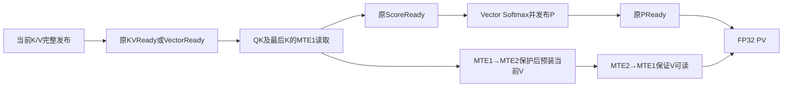

# q4 的混合 L1 B 数据流研究

本目录独立于生产。分母固定为 `decode_mdl_load/attention_candidate.cpp`，SHA `f2047dde10aa464202c23c8a8d39a9806c712ac8eb090ff752d7346d1b723151`；FE0、原生源码、精度配置和两个服务入口未修改。所有新内核均由 `generate.py` 可逆生成。

## 已完成的归因

`analyze_direct_nz.py` 读取已完成 directNZ 实验的两臂全六份 popped/completion gzip，并逐文件核 SHA。用实际 prepare tasks 的 SHA、每次 B 地址、FIXP ready、双 AIV producer flag 绑定所有 source/task。原始与紧凑结果在 `reports/fp32_dataflow_20261013/direct_nz_analysis.json`。

- 完整 directNZ 实验 934323→1143373 ticks，慢22.37%，该具体组合不能交付。
- 中间完整 history 轮周期 33103–33885→27065–27224 ticks。QK/PV 的 B 发布到结果 ready 分别约12770→7651、11725→7110 ticks；这些是交付跨度，不是 Cube 纯忙时。
- 后续 KV producer 在旧基底无暴露等待，新 NZ 有712–718 ticks；ScoreReady→PReady 从约5.9–6.6K 增至10.2–10.4K。因此不能将全部 unpack 成本直接从时间线上扣除。
- 真实 precise publisher 是完整退化的主要新增成本：AIV0共16次64行K/V发布，每次由1个自然FP32 DMA改成8轮 Gather+DMA，首DMA popped→末DMA complete约856→19215 ticks。AIV1另有8次；不能把两侧跨度相加为wall。

## 新的可证伪结构

用一个公开 `MatmulImpl` 和一块256KiB外部 `B1`：history 保持已逐位证明的压缩码字直接 NZ；window/current 保持母源自然 FP32 publisher，由 Cube 的 ND2NZ DMA 装入同一块 B1。这样去掉失败组合中 precise 的 FP32 Gather、永久索引和八轮发布。

这是每个 source 选择其已定义物理布局的统一消费者。不会在数值错误时换路，不是 native BF16 回退。QK/PV/softmax/Rv 的 FP32 输入、HF32关闭、每输出K128顺序、tail可见域、finite/error优先级、所有原 CV flags 和任务归属保持不变。一次初始化的Rv NZ常量仍为262144B，主机pack时间另记。

| 资源 | 数量 | 生命周期 |
|---|---:|---|
| GM/Cube | 1146880B | 两个固定KV256槽，不随历史增长 |
| 显式UB/AIV | 171680B | direct history helper，不含失败precise Gather索引 |
| 外部B1 | 262144B | 单槽，QK/PV/Rv顺序复用 |
| SDK L1 | 133120B，编译断言 | A128KiB及量化API预留2KiB |
| 合计L1 | 395264B，编译断言 | 不创建第二个Matmul实例 |
| L0A/B/C | 与母源相同，编译断言 | 每输出K128顺序不变 |

MTE1→MTE2事件保护上一轮L0装载仍在读取的B1；MTE2→MTE1事件保护本轮新B1。AIV原发布/消费屏障不删。官方 SDK `scheduler_mdl_base.h::InitSplitBParams` 在 full static + L1输入时取OrgN/OrgKb；二者均256，所以precise ND2NZ的 `dstNzC0Stride=256`，即使真实TailColumns只有16/64。这里只装有效矩形，MMAD仍仅处理真实n/k，不清空或消费未参与尾区。

SDK来源在 `artifacts/cann_sdk_l1_interface_20261013/provenance.json`。`PhyPosIsL1`明确接受B1；`CopyCubeInType::FROM_L1`直接借用LocalTensor且不分配B1；公开LocalTensor SetTensorB支持该接口。编译/CPU/完整模拟仍各自必须通过。

## 预声明门与执行

1. 同库完整短CPU：复用两个已冻结的 C1341 fixture，普通与非对称Rv，全部partial/LSE/status逐位、原空间oracle、所有任务、input/guard都通过。
2. C1341完整配对必须正收益。短形含较多固定窗口成本，不要求其独立达到1.15。
3. 长形固定 `q4_pair_c8193_8225`：24任务，62 history + 4 window + 2 current KV单位，1 Cube/2 AIV。相对同库MDL完整净速度必须≥1.15；原空间oracle、两臂partial/LSE/status位和完整六份trace全部通过才有此适用范围的组合资格。
4. 所有CAModel臂硬期限600秒。短trace每文件64MiB；本次新长形预声明256MiB/文件。资源与产物由root使用 `run_camodel_arm.py` 独占锁管理；无完成/截断/孤儿输出不得取ticks。
5. 先前相同长形CPU在120秒内未完成，原失败保留。本次长fixture严格复核旧输入hash，仅复用旧真实prepare metadata，不把它或旧算子输出当新CPU数学通过。新长CAModel仍重跑所有source、完整oracle与两臂位比较，并要求当前新核短CPU证明。

短构建/CPU接口沿 `CMakeLists.txt`，开关 `OSCAR_HYBRID_L1_ATTENTION_CPU_DEBUG=ON`，target `oscar_hybrid_l1_attention_cpu`。设备target `oscar_hybrid_l1_attention`。`run.py`跑短形；`long_runner.py`跑长形且显式要求 `--short-export` 指向本次完整短CPU报告。二者compare都验证当前source binding、同库、相同逻辑输入、真实exit/control和全六gzip。

## D.4 四问和适用范围

1. 对应 fused history dequant+FIA及精确源输入交付。
2. D.4旧全历史恢复6499.8–6655.1ms、写入209–215ms是禁区；不是当前百分比。
3. 固定KV256/单L1槽，无全历史恢复，数学与finite/错误域原样保留；#126/#145/#154决定跨pipe双向所有权，#129决定任务全覆盖，#148决定精度与模型证据边界，#157禁止改冻结guard。
4. 真实GM逻辑字节不减少；收益假设来自消除ND2NZ历史装载与precise重排相抵的成本。只有完整新配对支持倍率，不乘旧Normal→MDL比例。长形资格不是20–64K全服务或native2–4倍验收；NPU、graph、模型质量和整轮性能未验。

## 当前执行回执

root 已完成修正后的 CANN 与官方 CPU-debug 构建。普通/非对称 Rv 完整 CPU 双臂分别22.5544/21.0107秒、rc0、cleanup完成；全部输出位、oracle、Rv逆映射、输入不变及GM guards通过。真实候选源SHA为 `78a21cd466b1eff15991c1b6a1095402dfab2ed4c919b6a58536cad6ed2c56b1`。probe仍打印继承的 `DIRECT_NZ_CPU` 前缀，资格由source binding确认，不能将它误写为之前失败组合的重复运行。首轮编译的生成器重复声明错误及修复独立留档，未作为数值失败。

`run_sequence.py` 按短candidate→短baseline→短完整比较→长baseline→长candidate执行。每臂独占600秒，短形净正收益才进入长形。长日志配置只将SDK轮转阈值128MiB改成512MiB，实际硬文件上限仍256MiB，以免SDK先轮转造成“伪完整trace”；模型、L2及并行设置不变。

## 下一结构 v2：提前装载当前 V

`generate_prefetch.py` 从v1可逆派生独立 `attention_prefetch_candidate.cpp`。QK发原ready之后、等待PReady之前，将本轮已发布V装入同一B1；PV保留PReady等待并省去重复B装载。两种来源都由首KVReady/VectorReady证明当前K/V已完整发布；下一tile仍遵守旧双GM槽/PV消费链。无新增缓冲、字节或flags，所有AIV方法及status顺序逐字保持。

独立代理已审查上述所有权，未发现明确协议缺口，记录 `reports/fp32_dataflow_20261013/prefetch_source_review.json`。**v2只有源码审查，尚无CANN/CPU/CAModel/NPU/graph资格。** `package_prefetch.py` 可生成单独stage叠加包；必须放到新stage，不能覆盖仍用于v1配对及绑定验证的文件。新stage已在本机验证生成器/完整harness身份；这不是编译或速度通过。

图中只改变V装载的提交位置；P的依赖、计算顺序和结果ready保持原协议。这是源码设计的依赖图，不是NPU图捕获或性能证据。
