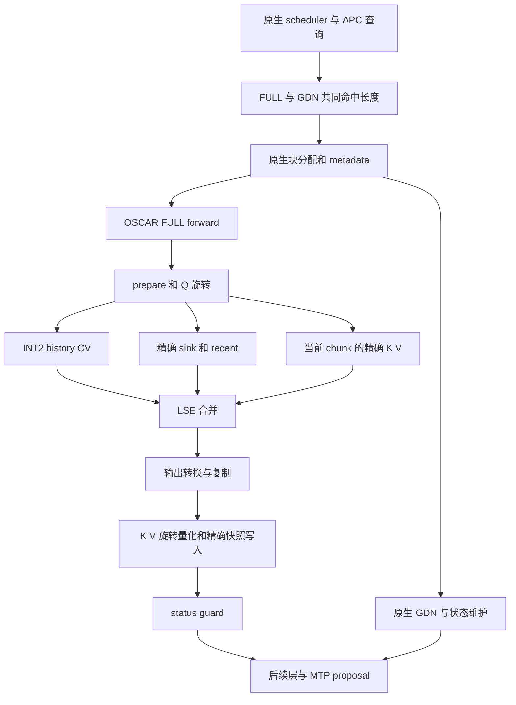

# 当前分支 OSCAR 与 Prefix Cache 源码分析报告

> 本报告保留原始源码分析边界；2026-10-13后续P0/P1实现、命中规则变化、命令与验收状态见 [prefix caching兼容闭环](prefix_caching_compatibility.md)。新规则不能倒写成原报告版本已经具备的行为。

分析对象为 `oscar-new-2` 分支的 `07a27358d6d8340556fd1452812101d238a4c2aa`，日期为 2026 年 10 月 13 日。结论来自当前 Python/C++ 实现、配置、指定 `references/` 原生代码、实际执行的主机测试，以及本分支保存的原始日志和机器可读实验产物。README、代码注释中的“已启用”“未启用”或性能结论均不作为实现依据。

**当前实现已建立压缩历史、精确窗口、原生 current attention 和 MTP 的完整调度路径，但不能从 INT2 编码或 APC 开关推导整机性能达标。最值得关注的三个结构性问题是：APC 命中受大物理页和稀疏 GDN 检查点共同限制；每轮历史读取仍伴随 FP32 展开和 Cube/Vector 之间的 GM 搬运；每页精确快照和原生混合页分配把 FULL 的实际容量收益压到了约 3 倍。**

本轮只交付分析、独立短探针、日志提取器和主机协议测试，不修改生产路由、原生树、AscendC 算子或冻结精度。源码身份见 [source_identity.json](../reports/source_analysis_20261013/source_identity.json)，有效启动计划见 [candidate-plan.json](../reports/source_analysis_20261013/candidate-plan.json)。本机为 Mac，无 `torch_npu`，没有新的 NPU、图或模型性能验收结果。

档案引用仅用于约束与证据边界：#17–20 对应字节/量化元数据；#34/#36 对应固定图容量；#37–49 对应窗口、回滚和物理所有权；#70–73 与 D.4 对应禁止全历史恢复、区分 host/device 时间；#94/#95/#125 对应实时失败和退出码；#127/#128 对应物理页/虚拟块；#130–135 对应超时和诊断扰动；#148/#152/#154/#155 对应精度及局部性能范围；#157 对应冻结 guard 归因。旧档案中的原因判定不替代本轮源码验证。

## 1 关键结论与优先级

| 结论 | 证据性质 | 对运行的影响 |
|---|---|---|
| 默认 candidate 开 APC，保留原生 token budget；没有 whole-prefill 调度器 | 当前 `variant_config` 和生成的启动计划 | chunk 大小必须从实际引擎/调度日志取得，不能继续套用旧 16K 假设 |
| 默认是物理页快照；request-window sidecar 默认关闭 | `runtime.py`、`serving_variants.py` | 不应把实验版窗口内存优势算进当前 candidate |
| 虚拟 128、hash 768、FULL 2304、GDN 768 是不同层次 | 原生 spec/coordinator 主机执行；目标几何有条件成立 | APC 不是 128 token 命中；MTP 和 GDN 还会使实际命中进一步减少 |
| 稀疏 GDN 检查点可使本可命中的 FULL 前缀变为零命中 | 本轮新增原生协议测试 | 仅用每 768 token 人工建状态的测试不足以代表真实 chunk 调度 |
| 历史按 KV256 分块读取，未见全历史 BF16 恢复 | 当前 CV 内核循环和固定 workspace | 避免旧恢复路径，但历史总读取/计算仍随历史长度增长 |
| q4 MDL、q1 bundle、C4/C16 window-range 都在 candidate 选择器中 | 真实分支选择及路由测试 | MDL 不能代表所有 prefill、MTP 和图形状均已优化 |
| 相同 APC 页被多个请求共享，不代表解包/attention 计算跨请求共享 | task 的 request/head/split 域；C4 聚簇条件 | 容量与 prefill 复用收益可以成立，decode 仍重复扫公共前缀 |
| 历史变成 FP32 后写 GM，再供 Cube 使用 | `PublishKv`、`Matmul`、softmax/PV 管线 | INT2 存储比不能直接当执行流量比，更不能当吞吐比 |
| 物理 FULL 容量收益约 3 倍，非 7.53 倍 | 当前布局整数账 | 窗口快照、对齐、GDN 和 workspace 必须进入容量分母 |
| passive 计时没有把 `current_only_copy` 计入 OSCAR phase 集 | `passive_timing.py::_OSCAR_PHASES` | residual 不应被全部解释成模型/GDN/通信成本 |

最先解决的是证据闭环：确认当前 APC 的真实命中长度，取得少量完整 step 的 target/draft/有效输出账；若失败，用冻结 guard 确认错误族。随后才对 FP32 数据供给、重复任务和小算子启动做净收益排序。

## 2 当前启动与插件边界

固定命令仍是：

```bash
git pull --ff-only && bash scripts/install_serve.sh --variant candidate
```

`tools/install_serve.py` 把 `variant_config` 生成的有效配置传给构建、旋转准备和正式服务。`tools/target_cli.py::serve_argv` 显式传 `--enable-prefix-caching`，省略 `--max-num-batched-tokens` 和自定义 scheduler。默认物理设备 0–3、端口 8989；仅 `--rear-cards` 使用 4–7、7878。目标 TP4、DP1、max sequences 128、max model length 262144，MTP speculative tokens 为 3，target 为 `FULL_DECODE_ONLY`，draft 配置为 eager。

candidate 实际启用 history reuse、fast unpack、mixed CV、striped cache、quantization bundle、current-only、first-MTP current FIA、compact later MTP、mixed decode split、decode bundle 和 MDL decode。whole-prefill 被归一化为关闭；C4 member pipeline 和 request windows 为研究开关，默认关闭。baseline 是 OSCAR fe0 路由，**不等于 native**；native 由相应入口显式禁用 OSCAR。

插件以延迟 hook 接入平台 backend 选择、cache spec、分配/reshape、metadata builder、MTP 调用和可选计时。GDN backend 和模型计算保持原生；FULL attention 由外部实现承担。默认物理快照路径没有接管 APC hash、refcount、eviction 和 scheduler。`allocate_kv_cache_tensors` 拒绝 KV transfer connector；报告的结论不延伸到跨机缓存迁移、CP、PP 或通用模型。

参考位置：`tools/serving_variants.py::variant_config`；`tools/target_cli.py::serve_argv`；`oscar_ascend/plugin.py::_patch_platform/_patch_runner/_patch_mtp_forward`；`integration/native_token_budget.py`。

## 3 OSCAR 的完整数据路径



### 3.1 三个 source 与数值语义

对一个 context 长度为 `C`、当前 query 绝对位置为 `p` 的请求，sink `S=64`，recent `R=256`。实现的可见区间可写为：

```text
sink_end = min(S, C)
cut = min(C, max(S, p + 1 - R))
source0  compressed history = [sink_end, cut)
source1  exact window       = [0, sink_end) ∪ [cut, C)
source2  exact current      = [C, p + 1)
```

实际 task 为一组 query 构造区间并逐 query 掩码，因此 task 的联合区间不能直接当每个 query 的可见量。当前 chunk 全部保留精确 BF16 输入，哪怕 chunk 长于 256；不是“全序列只保留最后 256 个精确 token”。

历史 K/V 在旋转域按每 token、每 KV head 独立量化，scale/zero 为 FP16；D256 的 K/V codes 共 128B，加 8B 元数据，共 136B/token/head。Q 旋转后与量化历史做 QK；历史输出经 V 的逆旋转回到原空间，再与 source1/source2 的输出按 LSE 合并。精确窗口存原始 BF16，不用量化结果替代。

生产链不调用 `oscar_ascend/ops/reference.py`。该文件是独立测试 oracle；当前实现也不以失败为条件切换到 dense 历史路径。

### 3.2 先读后写与 MTP 回滚

`impl.forward` 的顺序是 attention → merge/output → `store_current` → guard。长 chunk 不会在 attention 尚未读完旧 recent 窗口时覆盖它。writer 写全部合法 token 的 INT2，只为需要保留的 sink/recent 写原始 K/V。

精确快照每页预留 `64 + 256 + 3 = 323` 行，额外 3 行覆盖 speculative 写入前进后回滚的需求。recent 行映射为 `64 + inPage % 259`，tag 保存页内 token 位置。reader 用请求的原生块表定位物理页，再校验 tag。tag 自身不是完整 epoch；有效性依赖原生分配/共享规则和新写入的正确性，不能单凭 tag 相等证明任意复用安全。

完整 FULL 页共享后保持不可写；分叉请求各分配新的 writable suffix。跨页 recent 从相应旧页和新页读取，sink 从其真实所属页读取。没有每个命中请求先复制全部历史 KV 的步骤。

参考位置：`integration/impl.py::forward`；`csrc/kernels/attention_tasks.cpp::Run`；`csrc/kernels/rotate_clip_store_striped.cpp::RotateStore`；`attention_cv_mdl_decode.cpp::LogicalPosition/Physical/LoadWindowRuns/Softmax`；`lifecycle.py::SnapshotLayout`。

## 4 Prefix Cache 的真实命中粒度

### 4.1 四种粒度必须分开

以下数字基于当前原生主机测试的 Qwen3.5 TP4 几何：local Hq=6、Hkv=1、D=256、GDN BF16。实际服务应以模型 config、`cache_layout` 和原生 cache spec 复核。

| 层次 | 粒度 | 实际职责 |
|---|---:|---|
| 算子虚拟块 | 128 token | metadata 与 kernel 寻址，不拥有独立 APC 分配/refcount |
| 原生 hash block | 768 token | 形成 hash 链，较大组通过 `BlockHashListWithBlockSize` 聚合 |
| 原生 GDN align block | 768 token | 原生递归状态检查点；不是完整注意力 KV 页 |
| OSCAR FULL 物理块 | 2304 token | 原生 FullAttentionManager 的分配、共享、完整块缓存 |
| 混合组共同对齐 | LCM(2304,768)=2304 | 命中必须同时满足 FULL 与所有 GDN 组 |

FULL 页容量来自 `floor(ssm_bytes / (136 × lcm(mamba_block,128))) × lcm(mamba_block,128)`。`copy_with_new_block_size(128)` 只创建 metadata 视图，保留原 storage geometry；不会把一个 2304 页拆成 18 个可独立命中的 APC 页。

### 4.2 MTP 和最后一个 token 的双重边界

原生 `KVCacheManager.get_computed_blocks` 把查询上限设为 `prompt_tokens - 1`，保留 logits 重算。`SpeculativeConfig.use_eagle()` 包含 `mtp`；当前普通 Qwen 路径的 coordinator 为相关 FULL 组启用最后匹配块丢弃。`FullAttentionManager.find_longest_cache_hit` 在查到完整块后再 pop 一个块。

在 FULL 连续缓存、所有共同边界上 GDN 检查点都存在、没有驱逐等额外限制时，对完全重复 prompt 长度 `P`：

```text
H_upper(P) = 2304 × max(floor((P - 1) / 2304) - 1, 0)
实际命中 H <= H_upper(P)，并必须落在所有 GDN 组可用检查点上。
```

本轮直接执行指定原生 coordinator/managers 的主机边界结果：

| 重复 prompt token 数 | 命中 token 数 | 必须重算 token 数 |
|---:|---:|---:|
| 2303 | 0 | 2303 |
| 2304 | 0 | 2304 |
| 2305 | 0 | 2305 |
| 4608 | 0 | 4608 |
| 4609 | 2304 | 2305 |
| 6912 | 2304 | 4608 |
| 6913 | 4608 | 2305 |
| 9216 | 4608 | 4608 |

表是“检查点齐全”的协议结果，不是当前真机每种 prompt 的命中保证。部分共同前缀也必须经过相同 FULL/GDN 查询和 MTP 规则；不能只对公共 token 数做一次整除就宣布实际命中。

### 4.3 实际命中还受到 chunk 检查点稀疏性的限制

原生 `MambaManager.allocate_new_blocks` 在 align 模式下对跳过的历史块填 null，只维护当前状态和 speculative 状态。它没有在一个大 chunk 中为每个 768 token 自动生成全部中间状态。`AscendMambaManager.find_longest_cache_hit` 从后向前寻找真实缓存的状态，并要求共同对齐。

现有 `tests/test_prefix_caching.py::_cache_seed` 每 768 token 分配/cache 一次；它适合验证 refcount 和边界，却比真实大 chunk 的检查点分布更密。

新增 `tests/test_prefix_analysis_matrix.py` 使用同一原生管理器，分别按 768 和 1536 token 的步长保存状态，并调用正常 remove/free/cache 操作：

| seed 检查点间隔 | coordinator 查询上限 | 实际共同命中 |
|---:|---:|---:|
| 768 | 4608 | 2304 |
| 1536 | 4608 | 0 |
| 768 | 6912 | 4608 |
| 1536 | 6912 | 4608 |

第二行中 FULL 可以提供 2304，但 GDN 没有保存该边界的状态。1536 的检查点与 2304 对齐相交于 4608 的倍数；MTP 丢弃末块后可用边界更靠前。**1536 是用于隔离机制的合成调度步长，不是对当前服务默认 budget 的断言。**

若常规步长为 `C`，在理想等长 chunk 中共同检查点稀疏程度与 `lcm(C,2304)` 有关；实际混合 batch、尾 chunk、强制最后检查点和抢占使其不再固定。应记录真实 chunk 结束位置、GDN cache checkpoint、FULL 命中上限和最后共同命中，不能只记录最终一个百分比。

原生 `_mamba_block_aligned_split` 按 cache config 的原生 block 对齐，并存在 MTP 尾 chunk 调整；不保证每次都结束在 OSCAR FULL 的 2304 边界。即使 APC 命中率为零，开启 APC 导致的 GDN align 状态维护和 chunk 切分变化仍可能产生开销。

参考位置：`references/vllm/vllm/v1/core/kv_cache_manager.py::get_computed_blocks`；`single_type_kv_cache_manager.py::FullAttentionManager/MambaManager`；`references/vllm-ascend/vllm_ascend/patch/platform/patch_kv_cache_coordinator.py::find_longest_cache_hit`；`patch_mamba_manager.py`；`references/vllm/vllm/v1/core/sched/scheduler.py::_mamba_block_aligned_split`。

## 5 Chunked Prefill 的成本和正确性

第一个零历史 chunk 可由 `current_only_plan` 识别后缀请求，走 prepare/校验 → 原生 BF16 current FIA → copy/校验 → INT2 writer → guard，省掉没有意义的历史 Q 旋转和三源合并。判断依赖已有 CPU sequence upper bound 与 query length 相等，并保留设备端 context/slot 校验。它只识别连续的 fresh suffix，不会任意重排整个 batch。

后续 chunk 或 prefix hit 后的 continuation 具有正 context，仍执行压缩历史和精确窗口；当前 chunk 可用原生 TND FIA 生成 source2 partial，随后 LSE 合并。current-only 不能用于跳过已命中的历史。`common_prefix_len` 参数本身没有被 backend 用来实现共享前缀 attention 计算；实际复用由原生 scheduler 已计算 token 数、块表和 seq_lens 体现。

同一请求在 chunk `j` 开始时，历史长度约为先前所有 chunk 之和。每个新的 query group 会再读取其可见压缩历史。C4/C16 降低组内重复解包，但不消除长上下文 attention 的工作量。固定临时内存并不意味着总历史流量对长度亚线性。

对等长 chunk，忽略窗口边界及尾块，历史处理量可用以下量级估计：

```text
sum_j ceil(Q_j / query_group_tokens / eligible_cluster_reuse) × history_j
```

其中复用因子仅适用于内核真正满足 same-domain 的 source0 群组，不能无条件用 16。current FIA、QK/PV、softmax、store 和状态维护分别计账。减小 chunk 可能增加调度/启动次数、重复窗口读取、MTP padded 工作和 GDN checkpoint；增大 chunk 又会改变混合排队、workspace 与算法分支。因此本项目维持原生 budget，报告不建议通过抬高 budget 偷换比较条件。

APC 主要消除已命中 token 的模型 prefill，包括对应 FULL/GDN/MLP 工作；suffix query 的 attention 仍需访问完整可见历史。warm TTFT 改善不能算成 INT2 kernel 提速。冷/热路径还会改变哪些 token 在 current 段以精确 BF16 被读、哪些以历史 INT2 被读，不能要求量化模型的冷热输出天然逐 token 恒等；应将差异作为信号，另用冻结算子 oracle 和预定义模型质量门判断。

## 6 MTP 和混合批次

| 路径 | 当前 candidate 行为 | 仍需付出的成本 |
|---|---|---|
| target verify，q≤4、GQA≤8 | `attention_cv_mdl_decode_out` | 每个 target FULL 层的 prepare/rotate/CV/merge/store/guard，GDN 和模型其余计算 |
| 第一轮 draft | 经 builder 验证的 eager MTP；current partial 可用 native FIA，fresh suffix 可 current-only | 正历史仍完整读取；draft 层有自己的 KV 和旋转规则 |
| 后两轮 draft，q1 | `attention_cv_bundle_q1_out` | 每轮独立历史扫描、精确窗口、task/merge/store；不会沿用 target 层反量化结果 |
| later draft 大 padding | 当 `N>=1024` 且 `N>=8B` 时 compact 为 B 行 | tail slot 校验和 metadata 替换；保留原 N 的 CV split 决策 |
| 混合 prefill/decode | 对领先短请求和长后缀分两次 FULL forward | 更多启动/边界校验；收益须超过拆分成本 |

后续 draft 的原生 `seq_lens` 可能包含被拒绝的候选位置。`attention_tasks.cpp` 在 slotContext 模式下扫描虚拟块表，用 physical slot 找回真实逻辑位置；不使用 mRoPE 坐标代替 cache position。每个 live q1 token 的查找上界随 `ceil(seq_len/128)` 增长；64K 约 512 个表项，262K 约 2048 个。它不是历史 KV 解包，却是长序列中值得单独计时的 metadata 工作。

compact later MTP 是有条件的整个 MTP 模型输入裁剪：输入 ID、hidden、position 与 metadata 一起缩到 B，保留输出前 B 行语义，限定普通 TP、eager、无特殊通信/LoRA 路径。不符合其模型契约时显式报错；小 N 或第一轮则保留原路径。不能把所有 later draft 都假定成已裁剪。

mixed split 要求真实 eager metadata、前导 q≤4 请求存在、短 token 合计≤128、长请求达到聚簇阈值。GQA6 时阈值为 `4 × floor(128/6)=84`。它只拆 FULL 内部，不拆整模型，也不自动消除 GDN/MLP 的混合批次成本。实现保留原 `cv_shape_tokens`，因此“短分区选了 q4 kernel”不等于 splits 也改为纯 decode 的最佳值。

参考位置：`integration/first_draft_current_only.py`；`metadata.py::from_common`；`compact_later_mtp.py::_compact_call`；`mixed_decode_split.py::plan_mixed_decode`；`ops/cv_dispatch.py::select_cv_op`。

## 7 小算子与重复搬运清单

### 7.1 Python 层和设备小任务

标准 FULL 路径至少有 prepare、Q rotate、CV、merge、store、guard 六次显式自定义算子调用，另有 output FP32→BF16 copy 和按需 projection copy。对 16 个 target FULL 层加 3 次单 FULL draft，朴素数量级是每个 verify/proposal 周期约 114 次自定义调用；第一 draft/native current、混合拆分、额外校验会改变实际次数。graph 能减少 Python/host 提交成本，不会消除记录在图里的设备算子和依赖。

| 位置 | 具体工作 | 判断 |
|---|---|---|
| `GraphWorkspace.projection` | 非连续 Q/K/V 复制至固定 contiguous workspace | 当前 token 的拷贝；连续输入零复制，不能笼统计成全部必复制 |
| draft slots | int32→int64 copy | 受原生 draft metadata 类型驱动 |
| prepare | task tensor 为每 N×Hkv×3×S 行写 16 个 int64；非 leader/空 source 也处理 | 控制数据量与 padded N 有关 |
| current source suppression | compare、logical AND、where、copy | Python tensor 表达式可能产生多个小核，数量需设备 trace |
| current slot guard | compare、cast、status copy、guard | 正确性必需，不能无证据删除 |
| current partial | BF16 output 和 LSE 复制到 FP32 partial | 非零历史的 native current 路径会再次经过 merge |
| merge/output | split LSE 归并、FP32 输出及 BF16 copy | 小 Q 时启动/标量归约成本可能显著 |
| current-only copy | native output/LSE 规范化，再 `copy_validate_current_out` | 没有历史时仍有输出搬运/校验 |
| mixed split | stack/sub/compare/cast、额外 guard、qstarts 偏移 | 代价随层重复；只对适用 batch 有收益 |

同一 target step 的 query starts、seq_lens、slots 在多个同组 FULL 层之间往往相同，prepare 目前逐层执行，存在跨层复用 task/positions 的研究空间。但 task arena 由后续 source suppression 修改、不同分区会覆盖，draft_index/slotContext 也不同；必须绑定同一步、同 metadata 版本和完整 ABI，不能只按 buffer 地址复用。

### 7.2 writer 仍有 padding 和精确数据二次读

`rotate_clip_store_striped.cpp::RotateStore` 在检查 `slot<0` 之前已对 tile 做 K/V Load、Transform、Quantize。负 slot 阻止发布并清状态，但没有跳过前面的量化工作。Q 的 RotateOnly 则先检查 active slot，完全 inactive tile 可不做旋转。两者不能因共享文件/“bundle”名称而视为等价优化。

writer 的 `WriteRaw` 会再次从 current K/V 读取需保留的精确数据。长 chunk 通过同页后续 token 检查避免写必被覆盖的 ring 行，但每个完成物理页仍保留该页 recent 快照；decode 的每个新 token 通常既写 INT2 又写精确 ring。它节约长期缓存容量，不代表写流量自动减少到 INT2 大小。

### 7.3 历史 kernel 内部的搬运

当前 q4 MDL 路径：压缩 GM → AIV UB unpack/FP32 dequant → GM K/V tile → Cube QK → GM scores → AIV softmax → GM P → Cube PV → GM PV → AIV online accumulate；最后再旋转 history 输出。历史管线双缓冲 K/V，在 QK/PV 期间预取下一块，保留 KV/score/P/PV 等握手。

以 D256、KV256、Hkv1 的一个满历史 tile 为例，仅逻辑 K/V 字节为：

```text
INT2 读入            256 × 136             = 34,816 B
FP32 K/V 写 GM       2 × 256 × 256 × 4     = 524,288 B
Cube 再读 FP32 K/V   同量                  = 524,288 B
仅 FP32 K/V 写读合计                       = 1,048,576 B
```

这还未计 Q、score/P、PV、partial、LSE、旋转和可能的硬件重复读取。这里是程序逻辑 GM 流量账，**不能直接叫作 HBM 带宽账**：L2 命中、SDK ND→L1 供给和硬件重读决定实际 HBM 流量。也不能从这张账推定 Cube busy 或 Vector busy。

C4/C16 对同一 request/head/split 的合格 history query groups 复用一个解包 tile，最多降低对应部分的重复解包；每组仍有独立 QK/PV/softmax/accumulator。选择到 C4/C16 也不保证每个任务都满足聚簇条件。跨请求共享物理前缀、跨 target 层、跨 target/draft 均没有当前可用的共享浮点历史缓存。

## 8 当前算子选择与图路径

| 形状/条件 | candidate 选择 |
|---|---|
| q≤4、GQA≤8，非 later-q1 优先分支 | MDL decode |
| later draft，max_query_len=1，GQA≤8 | bundle q1 |
| max_query_len≥8192 | window-range C16 |
| GQA6 下 query/tokens 达到 84，未到 C16 阈值 | window-range C4 |
| 不足聚簇条件且 padded tokens>128 | window-range balanced |
| 其余小形状 | window-range 普通实现 |
| 合格零历史 suffix | current-only，提前返回，不进入上述 CV 选择 |

这些是 host 选择条件，内核仍校验 live qcount、request、source、位置和状态。MDL 只替换原 bundle decode 条目，没有替换 q1 或 C4/C16。

`GraphMetadataBindings` 检查已捕获 shape 对应的 device buffer 指针/shape/stride。图捕获用负 slot 标记 dummy，真实回放依赖原生 runner 在同地址更新 metadata。`update_graph_params` 没有 FIA host-length 属性重绑；draft eager 单独运行。应测试同一地址下更换块表、页复用、不同 sink/recent 边界及 MTP 接受长度后的回放，不能只验证第一次 capture 成功。

`attention_dispatched` 是 `emit_once`，`attention_progress` 有节流，current-only 提前返回不走末尾的标准 telemetry。缺少某条 dispatch 日志不能推出该路径没有执行。图回放本身绕过 Python inner phase，外层 `graph_replay` event 是整模型图时间，无法从中拆出每个 FULL 核。

## 9 容量评估

以下为当前源码重新计算的条件字节账，结果在 [memory.json](../reports/source_analysis_20261013/memory.json)。未把本机不存在的目标模型 config 冒充实机读取值。

| 一页的组成 | 字节 | 占 817152B 页的比例 |
|---|---:|---:|
| INT2 payload，2304×136 | 313344 | 38.35% |
| 精确快照，323×(1024+8) | 333336 | 40.79% |
| 未用于 FULL 的 conv 区 | 30720 | 3.76% |
| SSM 区剩余 | 79872 | 9.77% |
| snapshot padding 剩余 | 59880 | 7.33% |

纯编码比是 `1024/136=7.5294`。但同样的原生页预算，native FULL 存 768 token，OSCAR FULL 存 2304，稳态物理页容量比是 3。有限长度还受向上取整影响。按 65100 输入、512 输出、3 speculative reserve：

| 每请求每 rank 的分配账 | prompt 结束 | 输出结束加 MTP reserve |
|---|---:|---:|
| native FULL pages/group | 85 | 86 |
| OSCAR FULL pages/group | 29 | 29 |
| FULL 物理收益比 | 2.9310× | 2.9655× |
| 全部 KV 物理收益比，含 GDN 活跃保留 | 2.2727× | 2.2955× |

这里按原生混合分组、17 个共享 tensor 及 GDN 最大活跃状态保留记账；缓存中仍可驱逐的旧 GDN checkpoints、共享前缀分摊、权重、图、临时内存和碎片须另计。FULL 6–7 倍目标不能由当前页布局的 7.53 编码比宣告完成。

workspace 在模型装载期间分配、供顺序 FULL 层复用，不能再乘 17。以 Hq6/Hkv1/D256、20 Cube、C16 arena 为条件，实际代码返回：

| token capacity 假设 | workspace/rank |
|---:|---:|
| 2048 | 172418304 B，约 164.43 MiB |
| 8192 | 389842176 B，约 371.78 MiB |
| 16384 | 679740672 B，约 648.25 MiB |

这三个 capacity 仅用于敏感性分析；正式入口不指定它们。目标引擎实际容量与 graph arena 仍需从运行结果取得。APC 从 none 切到 align 后，在同一条件几何下 FULL block 从 2816 变为 2304，单页 token 容量减少约 18.18%；零命中也会承受这种几何变化。

实验 request-window 实现使用另一套双区域布局和按请求 sidecar，`seal_request_windows` 当前明确要求 APC=false、Mamba none；MDL+request_windows 组合也直接拒绝。其内存收益与实验 checkpoint prototype 不属于本轮默认 APC 生产能力。

## 10 性能评估与现有证据

### 10.1 用完整 step 衡量吞吐

```text
有效输出吞吐 = 实际参与 decode 的请求数 B × 每请求每轮有效输出 a / T_step

相对 native 的稳态倍率
  = (B_oscar / B_native) × (a_oscar / a_native) × (T_native / T_oscar)
```

`T_step` 应覆盖 target verify、采样/接受、全部 draft proposal、状态更新、通信和必需同步。MTP 的 q4 不是每轮必输出 4 token；接受率、EOS 和实际 proposal 数都会改变 `a`。`Running` 是驻留/调度状态采样，不能直接当当步 decode 的 B。完整轮次还包括 prefill 供给、排队、爬坡和排空。

例如，仅作敏感性计算，若实际 B 从 12 增至 32，a 相同，则要有吞吐收益，step 变慢必须小于 2.667 倍；若变慢 4 倍，吞吐只剩 native 的约 0.667。不能用“可驻留 32”替代这三个实测量。

冷请求总成本可写为模型新 token 工作＋历史 attention＋窗口＋写入＋GDN 状态＋调度/同步；热请求减少的是已命中 prefill 的工作，同时仍有 suffix 历史读取、状态恢复和尾块重算。分别报告 cold、warm、partial-hit 和 fork，避免把命中收益与 kernel 优化混在一个倍率中。

### 10.2 本地现存实测能支持什么

| 产物 | 可使用的数字 | 不能推导的结论 |
|---|---|---|
| `target_64k_mixed_20260929.txt` 原始复制日志 | 旧 OSCAR 3331.5501s、18.4419 output tok/s；旧 native 1371.9692s、44.7823 output tok/s；各完成120请求、61440输出 | 当前 HEAD 的总耗时、APC 重构后的净收益、835fc22 全程相位比例 |
| `decode_candidate_delivery_20261007.json` | q4 K32 20–30K 同输入 CAModel：16290667→9589788 ticks，1.69875× | 真 NPU HBM 效率、当前全模型吞吐 |
| `decode_mdl_load_20261012/completed/reports/mdl-comparison.json` | 同库小形状对比1079788→931042 ticks，1.15976×；partial/LSE/status 位一致、oracle通过 | q1/C4/C16 同倍率，或整体再乘1.15976 |
| `decode_critical_chain_20261012.json` | 小形状稳态周期中 QK/PV delivery 区间占约86.54% | Cube busy=86.54%，或整轮86.54%可优化 |
| `mdl_decode_fullbuild_20261012/summary.json` | CANN/Torch build完成；NPU/graph/service均not_run | NPU/图/模型质量通过 |

MDL、decode bundle、tasks 等当前源哈希与相应实验的绑定已核对，详见本轮 source identity；哈希匹配只确认是同一源文件，不扩展实验的形状、设备和范围。没有把注释里的旧性能结论直接当作实测。

当前 checkout 不含 `reports/target_64k_120_20261009.txt` 和其默认输出 `evidence_64k_120_20261009.json`；`tools/analyze_64k_evidence.py` 的默认路径并不保证文件存在。用户已运行过的 835fc22 AISBench 不再重跑，也不以更早的 20260929 日志替代该次缺失片段。

原始旧日志说明一个重要比较陷阱：OSCAR 平均 TTFT 为174.163s，低于 native 的235.052s，但 TPOT 为1382.8ms，明显高于 native 的212.1ms，总轮次反而慢约2.43倍。容量/入场带来的首 token 收益完全可能被后续 decode 成本抵消。这是旧负载现象，不是当前瓶颈占比的证明。

### 10.3 当前不能给出可信的绝对提速预测

源码证明了重复工作存在，尚不能确定当前真机最贵的是 unpack、GM/L1 供给、FP32 Cube、softmax、metadata、小核还是 GDN checkpoint。需要同一完整 step 的已完成事件和少量关键硬件 trace。对阶段串行部分可用 Amdahl 计算；对于 KV 预取与 QK/PV 的流水，必须按依赖关键路径计算，不能把双方 actor 时间相加。

短探针只负责识别方向和回归，不能代替完整模型质量、8分钟性能或新 AISBench 验收。本轮没有修改 `configs/acceptance.json`；其中 model_quality 的 logits/task/MTP tolerance 仍为 null，不能自行补一个宽松阈值后称通过。

## 11 测试覆盖与可运行脚本

### 11.1 本轮主机验证

测试范围覆盖 prefix/native manager、物理快照、layout、mixed split、compact later MTP、current FIA、q4/q1 路由、guard、入口配置以及本轮新增边界/日志工具。最终结果为 **340 passed、1 failed、2 subtests passed**；其中本轮新增的23项边界/工具测试通过。完整命令及退出码见 [validation.json](../reports/source_analysis_20261013/validation.json)，原始结果见 [pytest.log](../reports/source_analysis_20261013/pytest.log) 和 [pytest.xml](../reports/source_analysis_20261013/pytest.xml)。

既有 `test_native_token_budget.py::test_observe_candidate_gates_and_service_share_native_effective_config` 失败：测试 mock 列表未包含 `_mdl_decode_gate`，真实进入 `probe_mdl_decode` 并在本机缺少 `torch_npu` 时失败，rc=2，未到预期 mock service 的 rc=91。这个失败要如实保留；它不是 NPU 数值失败，也不应通过跳过生产 MDL 门解决。建议另行修正测试的隔离范围。

本地开发机可执行：

```bash
.venv/bin/python -m pytest -q \
  tests/test_prefix_caching.py tests/test_prefix_analysis_matrix.py \
  tests/test_runtime_native.py tests/test_lifecycle.py \
  tests/test_mixed_decode_split.py tests/test_compact_later_mtp.py \
  tests/test_mdl_decode_dispatch.py tests/test_decode_bundle_routing.py \
  tests/test_guard_diag.py tests/test_prefix_report_tools.py
```

该命令只用于已配置的本地开发环境，不是真机部署前置步骤。原生测试从 `references/` 提取原始类/函数 AST，依赖由测试 harness 提供；它证明被测管理协议，不等于真正启动完整 vLLM 引擎。

### 11.2 独立短服务探针

新增 [tools/prefix_cache_probe.py](../tools/prefix_cache_probe.py)，默认只打印计划，不启动服务、不安装、不 reset cache、不运行 AISBench。

```bash
python3 -m tools.prefix_cache_probe

# 已启动 candidate 后，在另一终端执行；目录必须不存在。
set -o pipefail
python3 -u -m tools.prefix_cache_probe --run \
  --base-url http://127.0.0.1:8989 --model qwen3.5 \
  --output reports/prefix-short-run1 2>&1 | tee reports/prefix-short-run1.console.log

# 后四卡服务只改变访问端口，不改变测试语义。
python3 -u -m tools.prefix_cache_probe --run \
  --base-url http://127.0.0.1:7878 --output reports/prefix-rear-run1
```

默认长度为2304、4608、4609、8192，每种长度包含 cold seed、完全重复 warm、两个并发公共前缀分叉、两个独立 salt 的 cold 分叉对照，共24个完成请求，每次8个输出 token。输入来自该服务 `/tokenize` 的合法 token ID，重复拼接构造精确长度，明确属于合成测试。不同长度用不同 cache_salt，减少相互污染；不清空其他请求的 cache。

每个 HTTP 请求由独立子进程执行，父进程施加120秒绝对死线；失败打印 traceback、保存结果并返回非零，不继续下一病例。SSE 必须有内容、finish_reason、usage 和 `[DONE]`，prompt/output usage 必须与要求匹配；HTTP 200 不算完成。返回 token IDs 时校验数量。记录 TTFT、完整 elapsed、chunk 时刻、usage、可用的 cached_tokens、输出指纹及分叉/冷热比较，并逐行保存原始 SSE，包括失败前已收到的片段。**chunk 次数不等于 token 数，脚本不据此伪算逐 token ITL。**

每病例保存 `/metrics` 前后快照。`prompt_tokens_details.cached_tokens` 在原生 serving 中受 `enable_prompt_tokens_details` 控制，且零命中可能被省略；缺失记为 null，而不是零。若未开启该响应字段，用无其他业务干扰时的 `prefix_cache_queries_total`/`prefix_cache_hits_total` 同标签 counter 差值确认整组是否命中；counter reset/其他请求会使归因失效。

单次冷热或分叉输出差异只记为敏感性信号，不作为自定义模型质量放行门。24请求默认计划用于路径和边界验证，不能据单次 TTFT 比值宣告性能提升。若已有短基准需要性能比较，应按冻结配置 warmup=2、repeat=5、median、逐病例比较，保留 cold 与 warm 独立样本，并匹配两侧命中 token 数。

### 11.3 后续真机覆盖矩阵

| 场景 | 最小覆盖 | 必须验证的内容 |
|---|---|---|
| APC 边界 | B−1/B/B+1、2B−1/2B/2B+1；B取实际物理页 | 命中 token、MTP末块重算、GDN共同边界 |
| 稀疏检查点 | 原生实际不同 chunk 结束位置、尾 chunk、混合调度 | FULL候选命中与GDN最终命中的差距 |
| 精确窗口 | sink边界63/64/65；recent切换；259 ring wrap；页边界 | 原始BF16窗口及tag、无陈旧读 |
| 分叉 | 两请求共享完整页后不同 suffix，交错执行/不同结束顺序 | shared页不写、私有尾页不同、输出对照 |
| 释放/驱逐/复用 | 小合成池中的free、abort、preempt/resume、evict、reset | 旧hash失效、旧tag不会冒充合法窗口；reset有live引用应拒绝 |
| MTP | q1/q2/q3/q4；接受0/1/2/3；页/窗口边界拒绝 | position由slot/table恢复；不读被拒绝候选 |
| graph | 同地址换真实输入、换页表、padding/live转换、回放多次 | 设备完成和输出/LSE/status一致，而非只capture |
| mixed | 短query＋512/8192等continuation；有/无正prefix context | 拆分前后同语义，短/长路由和split都记录 |
| 非法输入 | 错页表、错tag、NaN、live tail、超容量 | fail-closed，guard site/family可见 |
| 性能隔离 | 相同B/H/q、相同命中长度；再比较容量约束下实际B | 分开APC收益、kernel收益和MTP有效输出 |

现有 `tools.probe_ops`、`probe_mdl_decode`、`probe_decode_bundle`、`probe_first_mtp_current`、`probe_mixed_decode_split` 有各自独立 oracle/图/形状测试；它们不自动构成跨请求 APC 全服务测试。默认 physical snapshot 的完整 NPU APC 共享/复用矩阵仍需补齐。

真机首次验证流程仍使用工程已有 `bash scripts/install_probe_serve.sh`；独立真实算子门是 `python3 -m tools.deploy --only probe-ops`，无NPU必须失败。固定直启命令仅安装/编译/旋转/正式服务，不提供上述验收证据。本轮未给它增加任何测试或前置审计。

## 12 日志提取与观测方法

### 12.1 提取器和原始证据

新增 [tools/extract_prefix_evidence.py](../tools/extract_prefix_evidence.py)。输入明确的文件或一次运行目录，输出到新目录：

```bash
python3 -m tools.extract_prefix_evidence logs/一次运行目录 \
  --output reports/prefix-extract-run1

python3 -m tools.extract_prefix_evidence reports/target_64k_mixed_20260929.txt \
  --output reports/old-aisbench-extract-run1
```

它保留源文件SHA256、原始行号，提取有效 JSON、runtime selection、cache_layout、Engine/Spec采样、AISBench表格行和失败文本；支持 worker 前缀和同一行多个完整 JSON。破损/交错 JSON 不拼接猜测，也不提拔破损外层中的嵌套事件，输出未识别数量。阶段按 run_id/rank/pid/单位/stage/draft_index/shape/operator 分组；缺少 run_id 时以源文件隔离，不跨 rank 相加，不从主机耗时换算设备耗时。表格仅保留原始列，不替用户推断某段属于哪个版本。

旧 AISBench 复制日志的本轮提取结果在 [aisbench-extract/summary.json](../reports/source_analysis_20261013/aisbench-extract/summary.json)。该文件没有当前 OSCAR worker逐相位记录，提取器不会生成不存在的比例。

### 12.2 最小应保存的信息

每次短 probe 保存有效 target 配置、commit/本轮候选源身份、`PERF_RUNTIME_CONFIG`、`cache_layout`、真实请求usage/完成记录、启动和相位rc。运行时 geometry 至少包含 physical_block_tokens、page_bytes、cache_format、snapshot_bytes_per_page、scratch_bytes、实际原生token预算。模型数据不必上传或重新跑完整数据集。

命中账优先看每请求 cached_tokens，次选隔离负载中的 Prometheus counter 差值；Engine 百分比只作采样。推导多组共同命中时还需要原生host层的 FULL候选hit、GDN checkpoint和最终hit；当前默认 telemetry 未输出这三者，不能声称提取器能从已有日志完整还原。

### 12.3 三种计时不要混用

| 方式 | 得到什么 | 局限 |
|---|---|---|
| `OSCAR_TIMING=1` | Python相位host_s、shape和选择算子 | 异步launch时间，不是kernel设备耗时 |
| passive timing control | 有界抽样的异步NPU事件、target/draft/graph包络 | 只取已完成event；step跨stream可能missing；是样本，不代表全程 |
| device timing或debug sync | 同步设备区间、失败定位 | 改变调度/重叠；绝对时间不能直接用于原生无诊断性能比较 |

现有 `tools.summarize_timing` 汇总 debug-sync；`tools.summarize_device_events.summarize_device_events` 要求明确 run_id/ranks；`tools.summarize_profile` 分析已保存 CANN trace。不要因存在 profiler API 就对在线服务调用旧的 HTTP profiler 开始/停止，档案 #133 有该路径真机崩溃记录。

默认 guard 异常时可以用本工程既有、显式诊断命令复现一次：

```bash
git pull --ff-only && OSCAR_GUARD_HOST_SYNC=1 bash scripts/install_serve.sh --variant candidate
```

后四卡再追加 `--rear-cards`。它保持冻结 `status_guard.cpp`，以同一内核按族执行并同步，异常链给 `site=... family=...`；默认及 capture 路径不增加这种同步。诊断结果用于定位，不用来比较性能。没有失败现场，不能从最近打印的GDN memcpy或H2D调用反推真正首错算子。

### 12.4 当前观测代码的盲区

1. `passive_timing._OSCAR_PHASES` 未包含 `current_only_copy`。该耗时会落入 residual，不能把 residual 全算作原生/GDN/通信。
2. passive quota 为 prefill4、decode8、mixed4、unknown2，最多16个pending、每step256个phase。大mixed分区可能触及容量；必须检查skipped/pending/missing，不把少量早期样本当全程。
3. `accepted_tokens` 在 passive metadata 中为 null，只在metrics窗口层面另有记录。不能逐step精确求a，除非拿到同轮接受/输出证据。
4. graph replay 只得到整图区间，没有同次回放内部相位；原生current和history的eager样本不能直接分摊图时间。
5. `tools/analyze_service_log.py` 假设名义10秒采样，时间只取日内秒，可能不适合跨午夜或缺失Spec配对；其结果只能用于满足解析前提的片段。新提取器保留独立样本和原始行，不进行这种全程积分。
6. `emit_once`/progress节流不能统计算子总调用数；没有device completion证据时heartbeat只证明host仍前进。

## 13 可实施的优化方向及收益边界

| 优先级 | 方向 | 预期减少什么 | 前提与代价 |
|---|---|---|---|
| P0 | APC完整命中边界和失败归因验证 | 避免错误命中/陈旧窗口，建立可用基线 | 短probe、冻结guard；不能先调容差 |
| P1 | FULL物理页、hash与GDN检查点解耦的独立设计 | 尾块重算、短prefix零命中、每页重复窗口 | 新allocator/checkpoint/epoch协议；不能靠metadata128假拆页，不能修改原生GDN状态语义 |
| P1 | 测量并优化FP32供给关键路径 | INT2展开后的GM/L1搬运与暴露等待 | 必須含publisher、QK/PV/softmax和完整status；保持FP32冻结精度 |
| P1 | 重复prepare和任务控制开销复用 | 多FULL层相同metadata重复构建 | source2 suppression、arena覆盖、MTP位置和graph版本均需契约 |
| P2 | padding-aware writer与小核融合 | inactive量化、状态tensor改写、copy/launch | 不能漏非法live tail/metadata校验；与compact收益去重 |
| P2 | 根据真实检查点分布评估APC损失 | 识别为什么长公共前缀仍少命中 | 先观测；保持原生budget，不直接改scheduler补齐所有checkpoint |
| P2 | mixed短分区split/启动成本配对 | 小decode被大prefill形状拖累 | 当前保留原split，改动需oracle/graph/完整路径净收益 |
| P2 | APC共同历史跨请求计算复用研究 | 相同物理前缀的重复unpack | query不同，不能复用softmax/output；调度、页身份和跨请求生命周期复杂 |

单项比较使用相同当前优化基底、相同真实工作量，完整相关路径达到1.15倍且数值/协议通过才讨论组合；必要正确性修复不靠倍率放行。不要拼乘互相重叠的decode bundle/MDL/helper倍率，也不要为达标把GM流量直接解释成HBM流量。

上述脚本用于补齐当前 APC 命中边界、完成状态和阶段成本的证据。优化排序应以这些结果为依据，并同时记录完整 step 时间与 MTP 有效输出。
