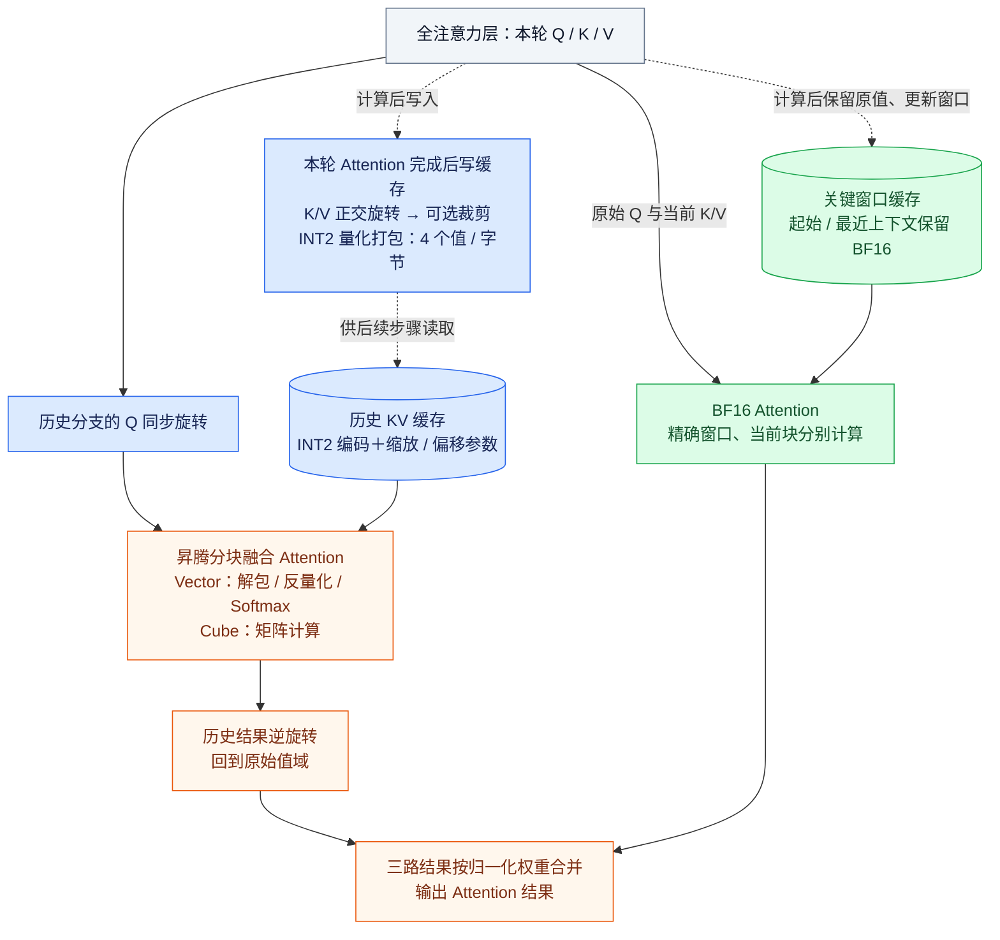

# IDEA方案描述

**项目名称：OSCAR-Ascend——面向昇腾大模型推理的 INT2 KV 缓存压缩与融合计算方案**

**【场景描述】**：在长文档问答、多轮对话和多用户并发等场景中，大模型需要持续保存并读取历史上下文的 KV 缓存。随着上下文和并发规模增长，缓存占用与访存开销不断增加，限制了昇腾设备可承载的请求规模。超低比特压缩可以降低缓存开销，但直接量化容易损伤精度，先将全部历史解压后再计算又会引入额外搬运成本。因此，需要让低比特存储、精度保护与昇腾计算路径协同设计。

**【方案实现描述】**：本项目基于 OSCAR 的低比特 KV 缓存方法，面向昇腾实现“**历史 INT2 压缩、关键窗口 BF16 保留、分块融合 Attention**”的推理流程，以外部插件和独立 AscendC 算子接入 vLLM Ascend。

1. **压缩历史，保留关键上下文。** 新 K/V 在本轮计算完成后，经正交旋转、可选裁剪和 INT2 量化，将每个元素编码为 2 bit，4 个值打包到 1 字节，并保存缩放与偏移参数。起始和最近窗口额外保留原始 BF16 值，当前输入块也直接使用 BF16，兼顾历史缓存容量与关键上下文精度。
2. **边读边算，避免完整历史展开。** 读取历史时，AscendC 算子按块解包、反量化，由 Vector 单元处理数据转换和 Softmax、Cube 单元完成矩阵计算；历史分支在旋转域计算后将输出变换回原空间，再与精确窗口、当前块的结果按归一化权重合并。工作区按块复用，无需在显存中重建完整 BF16 历史。
3. **接入真实服务，释放容量潜力。** 仅接管全注意力层的 KV 路径，保留混合模型中 GDN 线性注意力的原生状态与计算，并对接分页缓存、多卡并行和 MTP 多 token 预测流程。无需覆盖原生框架源码，为相同硬件承载更长上下文、更大并发批次提供基础。

*实线表示本轮计算，虚线表示计算后的缓存更新。三路分别使用历史 INT2、窗口 BF16、当前块 BF16，按互不重复的可见位置参与计算；INT2 用于缓存存储，Attention 仍进行浮点计算。裁剪按配置启用，当前默认关闭。*

**直观价值**：以每个全注意力层、每个 KV head、每个历史 token 的 K/V 维度均为 256 为例，BF16 K/V 需要 **1024 字节**，INT2 编码连同缩放、偏移参数仅需 **136 字节**，历史记录格式约压缩 **7.5 倍**。这一比例针对历史 K/V 表示，实际总显存收益还需计入精确窗口、页布局、GDN 状态和工作区，吞吐收益则由完整服务实测确定。

**落地进展**：项目已有昇腾 910B4 四卡运行 Qwen3.5-27B 的服务记录，历史版本完成过 16K、32K、50K 长请求。当前候选仍在排查前缀缓存与 MTP 兼容性，完整模型质量、实际总显存收益和端到端提速尚未验收。

<!--
文档核实日期：2026-10-13。本文为创新大赛方案简介，不将 OSCAR 已有算法本身声明为本项目首创。
源码依据：oscar_ascend/integration/impl.py（历史/窗口/当前三路，旋转、LSE合并、先读后写）；
oscar_ascend/integration/cache_storage_ops.py（裁剪默认0）；oscar_ascend/layout.py::SlotLayout（136/1024字节）；
csrc/kernels/attention_tasks.cpp、attention_cv.cpp（分块CV与三路计算）；rotate_clip_store.cpp（旋转/量化/打包与BF16窗口）。
档案引用：issue1_full_record.md #70–73与启动文档D.4约束完整历史展开；#126区分运行与数值通过；
#130–131约束长请求与并发验收；#156约束容量/吞吐外推；#157–158约束当前候选稳定性。
指定参考：references/oscar-vllm-pr46774；references/vllm；references/vllm-ascend，只读。
-->
