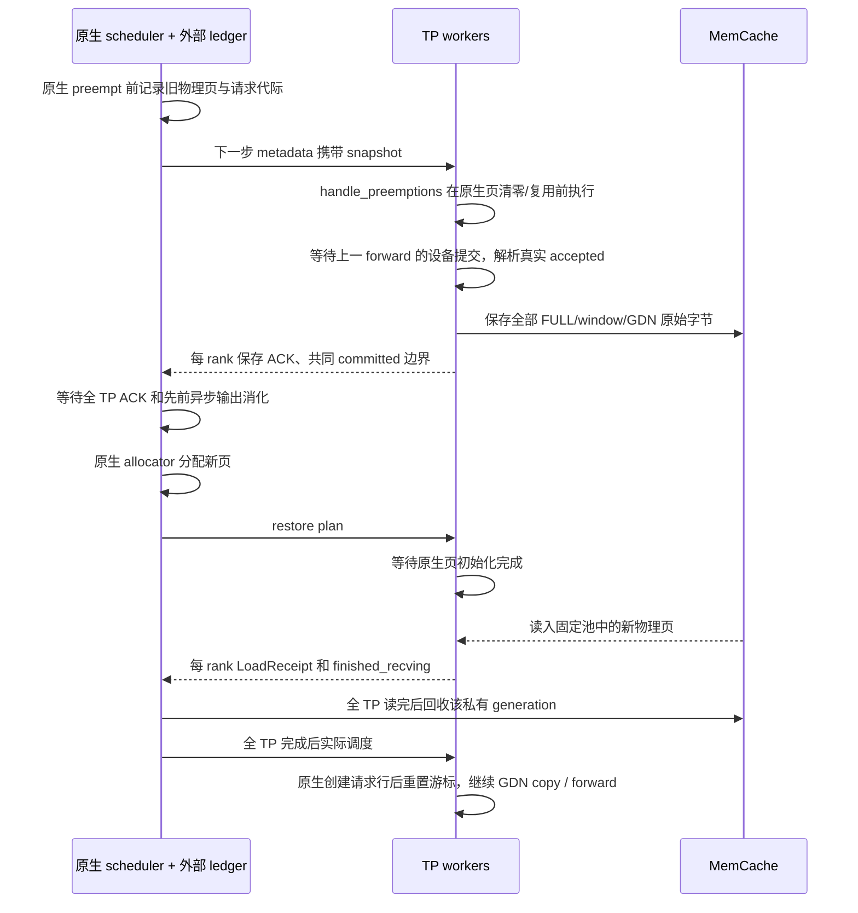

# OSCAR 的 AscendStore / MemCache 卸载接入

档案依据：#27/#34/#36（外部接缝、真实容量与图地址）、#37–49/#127/#128（物理页、none/align、GDN 与 metadata128）、#94/#125（实时错误与退出码）、#157/#163（MTP discard 与真实 prefill）、#171（联合 prompt checkpoint）、#172/#174（已接受数值及性能源保护）。本次没有新增真机错误记录，也没有修改 CANN、PT 生成、clip、旋转、timer 或原生参考树。

## 交付范围与验收边界

本次增加外部 `OscarAscendStoreConnector`，复用 AscendStore 的 MemCache backend 初始化及 V1 KV connector 调用链。代码覆盖当前 TP4 / DP1 / PP1 / CP1 混合模型的主动抢占恢复、原生 prefix cache、chunked prefill、none/align、MTP3、请求取消、streaming session 代际、缓存重置和资源释放。实际安装在固定 candidate 入口。node93 专用入口默认同时开启卸载与 APC，使用原生 align 策略；通用入口仍按其配置读取 APC。

最初提交时 MemCache 尚未部署；2026-11-10 用户已提供安装好的 SDK 和启动环境，并选择回滚至 `3d4fa54` 后仅对齐卸载启动参数。本地没有 NPU，且本轮明确禁止 agent 连接真机或测速。因此主机字节回归、原生调用链验证与真实本机 IPC 可记录为已运行；真实 SDK/NPU 传输、模型服务、图回放、质量与性能不能记录为通过。下面的设备与服务探针是可执行验收入口，不是已经取得的证据。

## 为什么不能直接把 AscendStoreConnector 接到 OSCAR

原生 AscendStore 的 FULL 数据模型和 OSCAR 不同。OSCAR FULL 层有 INT2 packed 数据、精确 K/V 窗口及窗口 tags；GDN 还有 conv 与 SSM 状态。只把原生 KV 指针或 packed 主体交给存储，会漏掉精确窗口或联合状态。按有效 token 比例截断 packed 页也不成立：页内布局包含不同分量和元数据，并非连续 token 行。

适配器只向 connector 导出物理布局，不更换模型收到的 tensor。每个对象按真实 storage offset、页 stride、dtype 和完整分量长度传输。末尾不足一页也保存整个物理页，逻辑可读范围仍由原生 committed token 长度约束。窗口 tags 是页内偏移，异址恢复不用重写 tag。

| 数据 | 保存内容 | 恢复位置 |
| --- | --- | --- |
| FULL | 每个已提交逻辑页的 packed、window K、window V、tags 原始字节 | 原生 allocator 新分配的相应物理页 |
| GDN conv | 原生 accepted 游标对应的 canonical 状态，尾部固定零填充 | 原生 running checkpoint 对应的 conv 页 |
| GDN SSM | accepted 后的已提交 SSM 列 | 同一 committed 边界对应的 SSM 页 |
| 主机元数据 | 请求代际、版本、边界、native salted block hash、全 TP 对象列表 | connector 元数据；不改 native hash 或页表 |

存储层不反量化、不重新量化、不逆旋转。恢复后的 attention 继续读取同一格式的缓存；OSCAR q4/q1/C4/C16、FP32 metadata、BF16 v4 和 recipe3 保持原逻辑。

## MemCache 的控制与数据路径

MemCache 的 MetaService/Config Store 管理分布式对象信息，worker 的 LocalService 提供配置的 DRAM。910B/A2 使用 `device_rdma`。每个 TP worker 注册固定 NPU 内存，使用 SDK `batch_put_from_layers` / `batch_get_into_layers` 的 L2G / G2L 方向传输；这里的 layers 是 SDK 的散布分量接口，本实现并不启用模型 layerwise offload。

原生 scheduler 创建 `init_bm=False` 客户端，可做元数据查询，不能用其执行 host 数据读写。因此 prefix manifest 的 host put/get 和私有对象回收通过本机 rank0 worker 的有界 IPC RPC 完成。数据主体仍直接走 NPU 注册地址。RPC 端点绑定 native engine ID，避免同机服务互相连接。

SDK 调用要求完整返回状态数组，拒绝异常、部分成功、非法长度和尺寸不符。读取先检查完整对象集合及对象大小，避免缺页仍进入 attention。SDK 超时由独立进程 watchdog 终止持有 DMA 地址的 worker；不能让超时线程继续访问已回收页。普通 prefix 查找未命中是 cache miss；已经承诺恢复的快照丢失则明确失败，不静默重算或回退。

前缀manifest读取也先检查存在性：未发布的候选索引直接返回miss，不调用会对缺失键打印ERROR的SDK Get。预查后读取为空仍再次确认是否被驱逐；对象仍存在却读空、SDK异常及校验失败继续报错。此顺序修正不缓存miss、不改变发布/查找范围，也不把所有SDK info invalid无条件吞掉。用户07:49日志已有外部命中40.6%及四rank前缀恢复；与本轮尚未部署的查询修复分开记录，详见档案#183。

### 2026-11-11：默认启用异步回载

`kv_offload.load_async` 默认是 JSON 布尔值 `true`，启动时传入 `kv_connector_extra_config.load_async=true`。旧 target 未写这个字段时也使用 true；显式布尔 `false` 保留同步路径，字符串 `"true"` / `"false"` 均拒绝。node93 入口直接执行 `bash scripts/start_node93_oscar.sh`，无需追加参数。启动 `KV_OFFLOAD_READY` 和实际完成的 `KV_OFFLOAD_RESTORE` 日志均标明 `load_async=true`。

这次同时实现后台读取和原生调度回执，不只是增加配置字段：

- 外部 prefix 命中或私有 swap 可恢复时，connector 向原生调度器返回异步加载标记。原生分配目标页、进入 `WAITING_FOR_REMOTE_KVS`，该请求暂不参与模型计算。
- worker 在原生新页清零之后记录 NPU event。每 rank 的单独 I/O 线程设置设备、等待该 event、执行原有严格 MemCache 检查和字节回载；主模型线程继续处理其他就绪请求。空模型步骤同样派发/轮询加载。
- SDK 成功返回后，每 rank 仅上报一次 `finished_recving`。原生收齐全 TP 完成才允许请求实际调度；待 `_update_states` 创建 input-batch 行后、`preprocess_mamba` 之前恢复 GDN/MTP 游标。全部 packed/window/tags/GDN 字节格式和图地址保持。
- 取消中的目标页由原生延迟释放，后台工作仍返回完成通知；私有源对象等全 TP load receipt 后回收。关闭时先排空 I/O 线程再注销 buffer。读取失败继续明确终止，不将失败当作 miss 或提前报告完成。

保存仍沿用原来的提交屏障；manifest 查询、全 TP/尺寸校验和 SDK 线程安全锁也保留。因此这是让回载与其他请求计算有机会重叠，不承诺消除全部卸载成本或已经提高吞吐。未连接真机、未运行性能测试。

本轮最终主机专项 **580 passed**：包含后台队列、实际原生空步/跨 TP 聚合/取消释放、none/align 字节恢复、部分本地 prefix 命中、同 ID 新代际、错误/关闭、streaming/reset、现有 PC/MTP 接缝、启动参数及本机真实 IPC。另独立运行冻结保护为43通过、1条已有 `tools/target_cli.py` 摘要断言失败；该文件与本轮修改前HEAD逐字节相同，两侧规范化SHA均为 `7b573587bacd6eddfecbc14576ad7a3ca4ac6fbe28e81932f0db97c12b359b44`，未更改或放宽这个断言。CANN/PT/timer与计算源码未修改，以上不等于真机或性能验收。

### 2026-11-10：参照原生实现减少查询与重复保存

依据档案#127/#128/#157/#163/#171/#182/#183，以及只读原生 `LookupKeyClient`、发送线程的存在性过滤，本轮在原有协议内优化控制路径：

- 最长候选保留一次manifest RPC的暖命中路径；缺失或payload不完整时，较短候选按最多256个索引批量检查，只有存在的索引才读取manifest。仍按长度降序选择完整checkpoint，不缓存miss。每个候选只读取终点原生hash，不再生成最终会丢弃的逐层逐页hash列表。
- RPC client复用context，并为每个调用线程保留独立REQ socket；失败交换关闭socket，不自动重发请求。超时后的迟到回复不能回答下一次请求。关闭client时释放全部连接；跨fork复用明确失败。
- 调度端在发布任务下发前统一检查同一终点已有索引。只有namespace/view/边界/keys与全TP payload全部完整，才省略本次共享prefix保存；缺失、驱逐或缺任一TP组件仍执行原保存。私有swap不去重，各worker不独立跳过保存。索引或payload在判断后被驱逐，只影响未来缓存可用性；后续lookup依然重新检查。
- DMA地址校验按已注册、互不重叠的owner区间二分查找，保留间隙、边界和跨相邻owner拒绝规则，避免每个segment扫描全部注册区间。

manifest格式、namespace、存储key和真实传输字节不变，已有缓存可继续读取。全TP检查、尺寸校验、提交事件、MTP/GDN状态记录、固定图地址、同步传输和末端checkpoint发布范围保持原合同；没有通过删除校验或改变异步加载政策换取调用量下降。并发新writer仍用独立generation，不删除可能被其他reader选中的共享payload。

主机调用计数回归：513个全部缺失候选从513次RPC降为3次（最长候选1次加两批256索引）；最长暖命中为1次RPC/1次终点hash读取。冷索引仍不调用SDK Get。这些是确定的主机工作量变化，不是NPU或端到端速度测量。既有 `start_node93_oscar.sh` 和固定candidate安装入口直接加载本实现，无新开关；端口7878、前四卡、16384预算、PC与卸载默认值保持。

验证命令：`.venv/bin/python -m pytest -q tests/test_offload_*.py tests/test_prefix_checkpoint_*.py`，440项通过。覆盖实际ZMQ IPC连接复用、线程隔离、超时迟到回复、SDK错误、并发发布、驱逐/缺页、全TP检查、写前去重、原生生命周期、chunked prefill、none/align及MTP提交边界。candidate卸载启动计划也已确认PC、端口、设备及预算；没有启动NPU服务或运行性能测试。

官方语义依据：[MemCache Python API](https://github.com/Ascend/memcache/blob/master/doc/memcache_python_api.md)、[MemFabric 文档](https://github.com/Ascend/memfabric_hybrid/blob/master/README.md)。本项目固定参考位置：`references/vllm-ascend/docs/source/user_guide/feature_guide/kv_pool.md`、`.../ascend_store/backend/memcache_backend.py`、`.../ascend_store/pool_worker.py` 及原生 V1 scheduler / runner。

### 每请求 prefix cache 命中日志

当前OSCAR入口默认在每条请求首次成功获调度时打印一行 `PREFIX_CACHE_REQUEST`，无需新增启动参数。例如：

```text
[oscar] PREFIX_CACHE_REQUEST {"request_id":"example","phase":"initial_schedule","prompt_tokens":4096,"local_hit_tokens":1024,"external_hit_tokens":2048,"total_hit_tokens":3072,"hit_rate_denominator":"prompt_tokens","local_hit_rate_pct":25.0,"external_hit_rate_pct":50.0,"total_hit_rate_pct":75.0}
```

三个百分比均以完整prompt token数为分母，合计为 `(local_hit_tokens + external_hit_tokens) / prompt_tokens`。external表示本地命中以外新增的外部前缀命中，不与local重复；它与原生周期汇总 `External prefix cache hit rate` 的剩余token分母不同，不能直接对比这两个百分比。

日志直接读取原生 `PrefillStats`，不新增缓存查询、设备回读或同步。只在EngineCore记录一次，后续chunked prefill、decode和私有swap抢占恢复不重复打印。关闭卸载或PC时也会记录实际本地/外部命中（无命中为0）；排队中就取消、尚未获得调度的请求没有此记录。`initial_schedule`表示本次成功调度采用的匹配数，不是DMA或整个prefill完成证明。原生计数缺失/非法时明确打印 `status=unavailable`，不编造0%或影响推理策略。

### PD融合的主模型step统计

同一默认入口也输出累计 `PD_STEP_STATS`：每100个已完成且可分类的非空主模型step打印一次；请求表清空时补齐未输出的尾段。每个EngineCore从服务启动开始累计，四个TP worker不会重复计数。示例（仅说明格式）：

```text
[oscar] PD_STEP_STATS {"scope":"engine_lifetime","count_basis":"completed_classified_main_model_steps","total_steps":100,"pure_decode_steps":70,"pure_prefill_steps":10,"mixed_steps":20,"excluded_steps":0,"pure_decode_pct":70.0,"pure_prefill_pct":10.0,"mixed_pct":20.0}
```

`pure_decode_pct = pure_decode_steps / total_steps × 100`。在原生调度推进token位置前，逐请求用 `num_computed_tokens < num_prompt_tokens` 判断是否处于prefill：全部为decode则纯decode，全部为prefill则纯prefill，同时存在则mixed。最后一个prefill chunk和只剩1 token的暖prefill仍为prefill；MTP的多token decode仍为decode。阶段快照保留在本step的scheduler output，不会被随后异步调度、抢占或取消改写。

只有主模型返回后，原生输出处理及OSCAR卸载状态更新均成功，才计数；不统计内部MTP draft调用，不新增设备同步，不修改timer。空调度及只有KV收发回执的空模型输出不纳入有效step；无法匹配完整请求集合或阶段信息缺失时计入 `excluded_steps`，不伪归为decode。异步KV错误通知可能属于其他请求，不能据此否定当前已经返回的主模型step。正常应满足 `total_steps = pure_decode_steps + pure_prefill_steps + mixed_steps`，有excluded时需同时查看这个缺口。该指标是批次中请求阶段的数量占比，不是decode图/内核选择或设备耗时占比。

两项日志的主机验证共117项通过：新增请求日志14项、PD step统计24项，加现有插件/原生prefix生命周期/卸载完成与reset等79项。包含读取实际原生PrefillStats、执行原生/AsyncScheduler更新方法、短prefill与MTP decode分类、异步阶段快照、周期/尾段打印、错误传播及卸载hook顺序；没有运行真机或性能测试。

## 主动抢占到恢复的状态机



原生 preempt 的释放和重新分配不被替换，也不 pin 全部被抢占页阻止调度器回收。worker 保存时机在 native `_update_states` 复用旧页之前；读取在其清零完成之后、forward 和图回放之前。不同 rank 的异步返回必须全部完成，不能以 rank0 成功代表 TP4 完成。

原生采样完成事件早于 MTP draft 完成，不能单独作为 prefix 发布屏障。本实现只在待发布 prefix 的步骤，通过原生 draft 后 `finalize_kv_connector` 记录 producer event；保存前等该事件和原生 GDN postprocess 流都完成。普通 decode 不新增这个事件或等待。原生空步仍执行 connector 回执聚合：即使最后一个请求结束，延后一拍的 prefix receipt 也能刷新到 scheduler。

MTP 接受长度来自设备 postprocess 的真实结果，而非 scheduler 的乐观长度。已提交位置为 `base + scheduled - speculative + accepted - 1`（存在 speculative 时）；无推测时为 `base + scheduled`。none 与 align 的 GDN canonical 选择遵循原生 copy 函数。#163 的真实 prefill mask/count 保持，不因 q_len=4 误作 decode。

streaming session 分叉传递旧/新代际和保留前缀的摘要；只有 worker 已提交边界与保留内容一致时才转移记录。不会直接放宽代际检查。

## Prefix cache 与 chunked prefill

沿用 #171 原生联合 checkpoint 边界：只有 FULL 与 GDN 都可读的位置才能发布。在原有 prompt terminal checkpoint 完成后，由每个 worker 保存独立 generation；scheduler 收齐全 TP receipt、验证完整 payload 后再发布共享索引。chunked prefill 的已有边界与调度预算不变，不逐 chunk 复制全历史，也不新建按长度分支。

索引使用原生包含 cache salt / LoRA / multimodal 等信息的 block hash，加上模型、实际加载的 PT tensor 内容、codec/math、物理布局和 TP world 的 namespace。开启卸载且未显式设置时，入口设置 `PYTHONHASHSEED=0` 以稳定原生起始 hash；不会替换原生 hash 实现。模型指纹沿用本项目描述文件/权重文件身份机制，不声称逐字节散列所有权重。

相同 prefix 的并发写各自使用独立 payload generation。manifest 只有完整集合才可发布；SDK duplicate 返回必须读取并检查已有赢家，不能假定覆盖或 CAS。读取验证 manifest checksum、namespace、边界和完整 keys，防止跨 PT、跨 rank 或新旧 generation 混合。

当前共享prefix只发布每个prompt最后的联合checkpoint，并不发布每一个中间chunk边界。2026-11-10主机审查复现：完整重复prompt可恢复，但共享较短中间前缀的请求在本地GDN页丢失后可能外部未命中；这是已知覆盖限制，不能据默认PC开关修正就保证与原生约70%的现场命中率相同。该限制不是用户本轮未开启PC时零命中的归因，未在此次启动修正中改动发布生命周期。

普通 native prefix reset 不影响活跃或等待恢复的 swap。成功的 force reset 才撤销相应活动状态；失败/异常保持 ledger。外部 prefix reset 切换本服务的 prefix view，拒绝旧 view 的迟到发布，保留已分配的恢复计划及活动 swap；不删除其他服务仍使用的共享对象。

## 所有权、资源与成本

所有注册 tensor 在服务期间保持存储地址；为 SDK 注册分配额外 2MiB 对齐余量，另有一个固定 canonical 零尾缓冲。它们计入真实 NPU 占用，不能假称零额外 HBM。图绑定地址不因卸载更换，传输发生在图之外。

保存以同步完成作为页所有权屏障；异步回载以全 TP receive completion 作为准入屏障。卸载/恢复会产生真实的流等待、网络和 DRAM 传输成本；不宣称隐藏了全部成本，也不以 INT2 压缩倍率代替吞吐收益。稳态 forward 没有新增全历史浮点恢复，worker 每步只保留小规模提交位置元数据，实际 D2H 元数据读取发生在需要快照时。

私有 swap 使用本服务 session / 请求代际 / 版本隔离。恢复全 TP 完成、取消、分叉、成功强制重置、或有效本地 APC 已覆盖时触发清理。迟到保存 ACK 仍参与回收；删除只允许服务端根据当前 scope 的结构化 plan 派生私有 keys，不接受任意删除列表。共享 prefix payload 是缓存对象，独立于私有 swap 生命周期。进程崩溃后的对象驻留及存储服务自身故障属于存储端运维边界，不能把 MemCache 当成持久化数据库。

必须单独说明容量边界：纯 DRAM MemCache 有高低水位驱逐，官方配置没有文档化的“关闭驱逐”选项。这里没有把原生 layerwise 读路径的 5 分钟 lease 假定为长期 swap 保活或自动续租。已卸载活动快照若被存储驱逐，恢复会明确报错，不能保证任意等待时长和任意存储压力下必然恢复。部署容量需覆盖活动快照与共享 prefix 的实际占用。公开的 SSD/UBS_IO 扩展有额外库和部署要求，未偷偷加入本次 DRAM 方案。依据：[MemCache 配置](https://github.com/Ascend/memcache/blob/master/doc/memcache_config.md)、[SSD 支持说明](https://github.com/Ascend/memcache/blob/master/doc/memcache_ssd_usage.md)。SIGKILL 或 SDK 硬超时也可能留下未回收 generation，不能声称异常退出后零遗留。

## 部署

### 2026-11-10：接续用户已安装的 MemCache

中央 MetaService 保持运行，在 OSCAR 工程目录执行：

```bash
bash scripts/start_node93_oscar.sh
```

本次回滚提交 `0e7af09` 的文件树与 `3d4fa54` 完全相同。此后新增的启动包装仅设置用户提供的卸载环境：`PYTHONHASHSEED=0`、`MMC_LOCAL_SERVICE_BACKEND_ID=1`、前四卡的 ASCEND/CUDA 可见列表，按 CANN→ATB→MemFabric→MemCache 顺序 source 已安装 SDK，指定 `/usr/local/memcache_hybrid/latest/config/mmc-meta.conf` 和 `mmc-local.conf`。它不创建配置、不启动或检查中央服务、不准备主机资源、不清理缓存。没有添加 `MMC_DIR_STORE_CONFIG_PATH`。

入口随后执行既有 `install_serve.sh --variant candidate --kv-offload --enable-prefix-caching`；编译、旋转文件准备和推理流程保持原样。卸载环境标记 `OSCAR_OFFLOAD_SDK_SOURCE=installed` 使部署仅补装卸载所需的 pyzmq，不让 pip 解析 MemFabric/MemCache SDK。普通入口未设置该标记时保持原有依赖安装行为。缺少或无法加载 SDK 时仍报错停止。也可以在当前 Bash 中 `source scripts/env_node93_memcache.sh` 后运行固定 `bash scripts/install_serve.sh --variant candidate`。

| 用户基线的卸载设置 | OSCAR 对应行为 |
| --- | --- |
| `backend=memcache`、`kv_role=kv_both` | 原有生成配置已包含这两项 |
| `AscendStoreConnector` | 保留 `OscarAscendStoreConnector` 外部适配，才能传输完整 packed/window/tags/GDN；底层复用原生 MemCache backend |
| `lookup_rpc_port="0"` | 复用原生 lookup IPC 路径函数的默认0，再追加 engine 标识隔离实例；它不是HTTP端口 |
| `load_async` | 按用户2026-11-11要求默认使用布尔 `true`，完整异步回载见上文；显式布尔 `false` 保留同步路径，不接受字符串值 |

`lookup_rpc_port` 继续由原有 IPC 路径管理；`load_async` 已加入 OSCAR 严格布尔选项。模型、token budget、RoPE、MTP、图模式、统计和数值配置保持回滚版本；HTTP端口按用户2026-11-10要求改为7878，node93入口另按用户要求默认开启APC。通用配置仍为16384、7878、APC关闭；不复制用户基线的4096、6969和YaRN参数。显式已有参数仍可传给包装入口；前后卡模式会让两种设备可见变量保持一致。

此前启动适配验证：111项卸载配置/传输/部署、固定argv和直启流程回归通过，另14项临时SDK stub的shell测试通过，覆盖source顺序、环境传递、失败停止及真实退出码。端口调整前，`configs/`、`csrc/`、`oscar_ascend/`、`tools/serving_variants.py`和`tools/install_serve.py`与3d4fa54逐文件一致；此次仅将target.json的port改为7878。shell语法及diff检查通过。测试未加载真实SDK/NPU，不能作为本次现场链路、四卡启动或SSD回读验收。

### 独立环境的配置生成（已有配置无需执行）

安装使用当前 Python 环境，依赖 `memfabric-hybrid`、`memcache-hybrid`、`pyzmq`。无需复制或覆盖 native 源码。以下变量必须用用户实际提供的地址、容量填写；配置生成命令不会连接网络或启动服务：

```bash
python3 -m tools.memcache_config generate \
  --output-dir /absolute/path/oscar-memcache \
  --meta-url "$META_SERVICE_URL" \
  --config-store-url "$CONFIG_STORE_URL" \
  --dram-gib "$DRAM_GIB_PER_RANK"
source /absolute/path/oscar-memcache/environment.sh
```

`--dram-gib` 是每个 LocalService / TP rank 的容量，TP4 总 DRAM 为其四倍；`--world-size` 是最大 LocalService 数量，默认 256，不是 TP 数。910B 使用 `device_rdma`；RoCE、接口、hugepage 和 SDK/CANN 兼容性按真实部署环境配置，工具不修改系统 sysctl。可显式提供 `--local-ip` 与 `--interface` 一起生成通讯环境；不猜地址或网卡名。

在配置对应的 MetaService 主机、独立终端前台运行：

```bash
python3 -m tools.memcache_config serve-meta --config /absolute/path/oscar-memcache/mmc-meta.conf
```

服务机读取 `MMC_LOCAL_CONFIG_PATH` 后，固定直启命令实际启用卸载：

```bash
git pull --ff-only && bash scripts/install_serve.sh --variant candidate
```

上面的通用入口需要 prefix cache 时显式追加 `--enable-prefix-caching`；`start_node93_oscar.sh` 已默认添加，无需用户再传。显式 `--no-enable-prefix-caching` 可覆盖 node93 默认值。后四卡继续追加 `--rear-cards`。默认预算 16384、设备 0–3、端口 7878、原生 async scheduler / MTP3 / FULL_DECODE_ONLY 均保持。显式 `--no-kv-offload` 可选择原有无卸载运行；它不是故障后的自动回退。配置/SDK/传输错误会中止，不会偷偷忽略卸载。

直启入口按原授权只安装、编译、准备 PT 和启动，不跑测试。完整探针入口：

```bash
bash scripts/install_probe_serve.sh
```

它依次运行现有算子正确性门、全 TP 的真实 SDK/NPU 字节传输及 manifest RPC、none/align 短服务卸载探针、现有完整服务探针，任一失败禁止正式服务。独立卸载探针也可运行：

```bash
python3 -m torch.distributed.run --standalone --nproc-per-node 4 \
  -m tools.probe_kv_offload --output-json reports/kv-offload.json
python3 -m tools.probe_kv_offload_service \
  --config /absolute/path/effective-target.json --output-dir reports/kv-offload-service
```

服务探针启动 none/align 各自的基准与小池压力服务，通过观测真实物理页计算会触发原生抢占的容量，仅探针显式修改 chunk budget / 池容量。要求原生 preemption 指标增长、所有 rank 相同 generation 和 committed 位置的 SAVE/RESTORE、MTP 执行指标、恢复前后精确 token IDs 一致；align 还必须有非最终 chunk 发布、native local prefix reset 后远端命中与全 TP 恢复。不是以 HTTP 200 代替恢复证据。所有服务生命周期都检查资源清理。

## 实现与回归索引

| 文件 | 责任 |
| --- | --- |
| `oscar_ascend/offload/layout.py`、`identity.py` | 真实物理布局、注册区域、加载 PT 绑定和远端 namespace |
| `scheduler.py`、`state.py`、`hooks.py` | 原生调度生命周期、异步提交、GDN canonical 与恢复游标 |
| `connector.py`、`plans.py` | V1/HMA 接缝、全 TP 发布/恢复、对象身份与回收 |
| `async_load.py` | 单线程后台回载、非等待完成轮询、错误传播与排空关闭 |
| `transport.py`、`metadata.py` | 严格 SDK 状态、watchdog、rank0 IPC、manifest 一致性 |
| `tools/memcache_config.py` | 显式部署配置与前台 MetaService |
| `tools/probe_kv_offload*.py` | 真实设备字节与模型服务验收入口 |
| `tests/test_offload_*.py` | 主机字节/原生调用链/故障注入/IPC/配置回归 |

主机回归包括：none/align、MTP 接受 1–4、末尾半页、旧页清空复用后异址恢复、全部窗口/GDN 字节对比、全 TP ACK、迟到输出、session 分叉、prefix 并发发布、重置隔离、注册失败/缺页/部分状态/尺寸错误、阻塞 SDK watchdog 和真实本机 RPC。冻结回归只反向移除精确列明的卸载接缝后校验既有源码 SHA；CANN 源码身份门不修改。最终运行统计另列于本次主机验证记录。

最终专项 **659 passed / 0 failed / 0 skipped**。全仓库运行 **3022 passed / 53 failed / 8 errors / 141 skipped**，另有 29 个 subtest 通过；53 个失败和 8 个错误的用例集合与 `fdb8eba` 基底完全一致，主要是已有旧政策断言、缺失历史日志/模型和本机 C++ 工具链。最末 probe 远端清理及部署门增量已纳入 659 项最终专项复测。没有把全仓库运行写成全通过。机器可读记录含已知失败集合、基底对照、最终生产文件 SHA 与保护文件列表：[host_validation.json](../reports/kv_offload_20261109/host_validation.json)。缺 NPU 时设备探针以退出码 1 和明确的 `torch_npu` 缺失错误结束，未替换为 CPU 通过。
