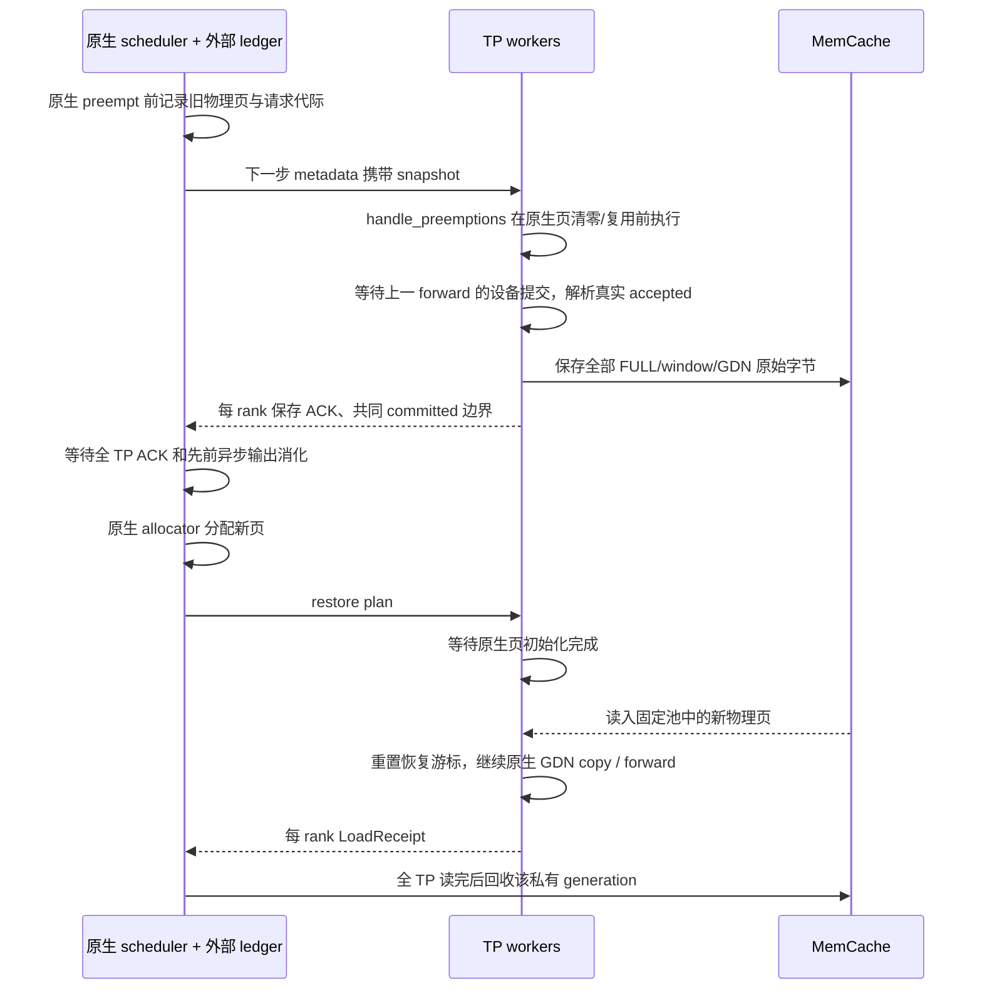

# OSCAR 的 AscendStore / MemCache 卸载接入

档案依据：#27/#34/#36（外部接缝、真实容量与图地址）、#37–49/#127/#128（物理页、none/align、GDN 与 metadata128）、#94/#125（实时错误与退出码）、#157/#163（MTP discard 与真实 prefill）、#171（联合 prompt checkpoint）、#172/#174（已接受数值及性能源保护）。本次没有新增真机错误记录，也没有修改 CANN、PT 生成、clip、旋转、timer 或原生参考树。

## 交付范围与验收边界

本次增加外部 `OscarAscendStoreConnector`，复用 AscendStore 的 MemCache backend 初始化及 V1 KV connector 调用链。代码覆盖当前 TP4 / DP1 / PP1 / CP1 混合模型的主动抢占恢复、原生 prefix cache、chunked prefill、none/align、MTP3、请求取消、streaming session 代际、缓存重置和资源释放。实际安装在固定 candidate 入口，默认 APC 仍关闭；启用 APC 时使用原生 align 策略。

初始开发时 MemCache 部署地址与容量未提供；用户随后提供了 node93 的现场配置，并选择 DRAM＋SSD benchmark，具体见下方 node93 配置节。本地没有 NPU，本轮也没有连接真机或测速。因此主机字节回归、原生调用链验证与真实本机 IPC 可记录为已运行；真实 SDK/NPU 传输、模型服务、图回放、质量与性能不能记录为通过。下面的设备与服务探针是可执行验收入口，不是已经取得的证据。

## 为什么不能直接把 AscendStoreConnector 接到 OSCAR

原生 AscendStore 的 FULL 数据模型和 OSCAR 不同。OSCAR FULL 层有 INT2 packed 数据、精确 K/V 窗口及窗口 tags；GDN 还有 conv 与 SSM 状态。只把原生 KV 指针或 packed 主体交给存储，会漏掉精确窗口或联合状态。按有效 token 比例截断 packed 页也不成立：页内布局包含不同分量和元数据，并非连续 token 行。

适配器只向 connector 导出物理布局，不更换模型收到的 tensor。每个对象按真实 storage offset、页 stride、dtype 和完整分量长度传输。末尾不足一页也保存整个物理页，逻辑可读范围仍由原生 committed token 长度约束。窗口 tags 是页内偏移，异址恢复不用重写 tag。

| 数据 | 保存内容 | 恢复位置 |
| --- | --- | --- |
| FULL | 每个已提交逻辑页的 packed、window K、window V、tags 原始字节 | 原生 allocator 新分配的相应物理页 |
| GDN conv | 原生 accepted 游标对应的 canonical 状态，尾部固定零填充 | 原生 running checkpoint 对应的 conv 页 |
| GDN SSM | accepted 后的已提交 SSM 列 | 同一 committed 边界对应的 SSM 页 |
| 主机元数据 | 请求代际、版本、边界、native salted block hash、全 TP 对象列表 | connector 元数据；不改 native hash 或页表 |

存储层不反量化、不重新量化、不逆旋转。恢复后的 attention 继续读取同一格式的缓存；OSCAR q4/q1/C4/C16、FP32 metadata、BF16 v4 和 recipe3 保持原逻辑。

## MemCache 的控制与数据路径

MemCache 的 MetaService/Config Store 管理分布式对象信息，worker 的 LocalService 提供配置的 DRAM。910B/A2 使用 `device_rdma`。每个 TP worker 注册固定 NPU 内存，使用 SDK `batch_put_from_layers` / `batch_get_into_layers` 的 L2G / G2L 方向传输；这里的 layers 是 SDK 的散布分量接口，本实现并不启用模型 layerwise offload。

原生 scheduler 创建 `init_bm=False` 客户端，可做元数据查询，不能用其执行 host 数据读写。因此 prefix manifest 的 host put/get 和私有对象回收通过本机 rank0 worker 的有界 IPC RPC 完成。数据主体仍直接走 NPU 注册地址。RPC 端点绑定 native engine ID，避免同机服务互相连接。

SDK 调用要求完整返回状态数组，拒绝异常、部分成功、非法长度和尺寸不符。读取先检查完整对象集合及对象大小，避免缺页仍进入 attention。SDK 超时由独立进程 watchdog 终止持有 DMA 地址的 worker；不能让超时线程继续访问已回收页。普通 prefix 查找未命中是 cache miss；已经承诺恢复的快照丢失则明确失败，不静默重算或回退。

官方语义依据：[MemCache Python API](https://github.com/Ascend/memcache/blob/master/doc/memcache_python_api.md)、[MemFabric 文档](https://github.com/Ascend/memfabric_hybrid/blob/master/README.md)。本项目固定参考位置：`references/vllm-ascend/docs/source/user_guide/feature_guide/kv_pool.md`、`.../ascend_store/backend/memcache_backend.py`、`.../ascend_store/pool_worker.py` 及原生 V1 scheduler / runner。

## 主动抢占到恢复的状态机



原生 preempt 的释放和重新分配不被替换，也不 pin 全部被抢占页阻止调度器回收。worker 保存时机在 native `_update_states` 复用旧页之前；读取在其清零完成之后、forward 和图回放之前。不同 rank 的异步返回必须全部完成，不能以 rank0 成功代表 TP4 完成。

原生采样完成事件早于 MTP draft 完成，不能单独作为 prefix 发布屏障。本实现只在待发布 prefix 的步骤，通过原生 draft 后 `finalize_kv_connector` 记录 producer event；保存前等该事件和原生 GDN postprocess 流都完成。普通 decode 不新增这个事件或等待。原生空步仍执行 connector 回执聚合：即使最后一个请求结束，延后一拍的 prefix receipt 也能刷新到 scheduler。

MTP 接受长度来自设备 postprocess 的真实结果，而非 scheduler 的乐观长度。已提交位置为 `base + scheduled - speculative + accepted - 1`（存在 speculative 时）；无推测时为 `base + scheduled`。none 与 align 的 GDN canonical 选择遵循原生 copy 函数。#163 的真实 prefill mask/count 保持，不因 q_len=4 误作 decode。

streaming session 分叉传递旧/新代际和保留前缀的摘要；只有 worker 已提交边界与保留内容一致时才转移记录。不会直接放宽代际检查。

## Prefix cache 与 chunked prefill

沿用 #171 原生联合 checkpoint 边界：只有 FULL 与 GDN 都可读的位置才能发布。在原有 prompt terminal checkpoint 完成后，由每个 worker 保存独立 generation；scheduler 收齐全 TP receipt、验证完整 payload 后再发布共享索引。chunked prefill 的已有边界与调度预算不变，不逐 chunk 复制全历史，也不新建按长度分支。

索引使用原生包含 cache salt / LoRA / multimodal 等信息的 block hash，加上模型、实际加载的 PT tensor 内容、codec/math、物理布局和 TP world 的 namespace。开启卸载且未显式设置时，入口设置 `PYTHONHASHSEED=0` 以稳定原生起始 hash；不会替换原生 hash 实现。模型指纹沿用本项目描述文件/权重文件身份机制，不声称逐字节散列所有权重。

相同 prefix 的并发写各自使用独立 payload generation。manifest 只有完整集合才可发布；SDK duplicate 返回必须读取并检查已有赢家，不能假定覆盖或 CAS。读取验证 manifest checksum、namespace、边界和完整 keys，防止跨 PT、跨 rank 或新旧 generation 混合。

普通 native prefix reset 不影响活跃或等待恢复的 swap。成功的 force reset 才撤销相应活动状态；失败/异常保持 ledger。外部 prefix reset 切换本服务的 prefix view，拒绝旧 view 的迟到发布，保留已分配的恢复计划及活动 swap；不删除其他服务仍使用的共享对象。

## 所有权、资源与成本

所有注册 tensor 在服务期间保持存储地址；为 SDK 注册分配额外 2MiB 对齐余量，另有一个固定 canonical 零尾缓冲。它们计入真实 NPU 占用，不能假称零额外 HBM。图绑定地址不因卸载更换，传输发生在图之外。

本实现以同步完成作为页所有权屏障。卸载/恢复会产生真实的流等待、网络和 DRAM 传输成本；不宣称隐藏了这些成本，也不以 INT2 压缩倍率代替吞吐收益。稳态 forward 没有新增全历史浮点恢复，worker 每步只保留小规模提交位置元数据，实际 D2H 元数据读取发生在需要快照时。

私有 swap 使用本服务 session / 请求代际 / 版本隔离。恢复全 TP 完成、取消、分叉、成功强制重置、或有效本地 APC 已覆盖时触发清理。迟到保存 ACK 仍参与回收；删除只允许服务端根据当前 scope 的结构化 plan 派生私有 keys，不接受任意删除列表。共享 prefix payload 是缓存对象，独立于私有 swap 生命周期。进程崩溃后的对象驻留及存储服务自身故障属于存储端运维边界，不能把 MemCache 当成持久化数据库。

必须单独说明容量边界：纯 DRAM MemCache 有高低水位驱逐，官方配置没有文档化的“关闭驱逐”选项。这里没有把原生 layerwise 读路径的 5 分钟 lease 假定为长期 swap 保活或自动续租。已卸载活动快照若被存储驱逐，恢复会明确报错，不能保证任意等待时长和任意存储压力下必然恢复。部署容量需覆盖活动快照与共享 prefix 的实际占用。用户已选择 DRAM＋SSD，存储下沉由安装的 SDK 实现；本地配置准备不证明 SSD 已启用，也没有增加存储保活保证。SSD 配置以安装版本为准；DirStore 目录字段与 UBS IO 裸盘字段不能互相替代。依据：[MemCache 配置](https://github.com/Ascend/memcache/blob/master/doc/memcache_config.md)、[SSD 支持说明](https://github.com/Ascend/memcache/blob/master/doc/memcache_ssd_usage.md)。SIGKILL 或 SDK 硬超时也可能留下未回收 generation，不能声称异常退出后零遗留。

## 部署

### node93 本轮 benchmark 配置（用户已确认）

`configs/benchmark_node93.json` 绑定物理卡 **0,1,2,3** 和模型 HTTP 端口 **7878**，复用现场已经安装的私有 SDK；后续基线教程适配见 [接续部署说明](node93_baseline_alignment_20261110.md)。模型、TP4/MTP3、16384 token budget、图模式和默认 APC 策略保持。**不要追加 `--rear-cards`**，该选项会切到 4–7 卡。通用 `target.json` 默认端口仍为 8989。

| 现场配置项 | 用户提供的值 |
| --- | --- |
| LocalService 文件 | `/usr/local/memcache_hybrid/latest/config/mmc-local.conf` |
| MetaService 文件 | `/usr/local/memcache_hybrid/latest/config/mmc-meta.conf` |
| MetaService / Config Store | `tcp://127.0.0.1:5000` / `tcp://127.0.0.1:6000` |
| MetaService metrics | `http://127.0.0.1:8000` |
| 用户报告安装版本 | MemCache `1.2_260917`，MemFabric `1.2_260917` |
| 通讯协议 / 最大 rank 数 | `device_rdma` / `256` |
| DRAM | 最新每个 LocalService `40GB`；四个贡献内存的 TP worker 配置合计 `160GB`，不含其他进程和 SDK 开销 |
| 驱逐高/低水位 / Meta 日志等级 | 最新 `70` / `60` / `error` |
| rewarm / prefetch | `ock.mmc.rewarm.dram_watermark=95` / `ock.mmc.storage.prefetch.enabled=true` |
| SSD 意图 | `ock.mmc.local_service.storage.enabled=true`；用户选择包含 SSD |
| DirStore 配置路径 | `MMC_DIR_STORE_CONFIG_PATH=/usr/local/memcache_hybrid/latest/config/dir_store.conf`；用户确认文件尚不存在 |
| 已知 DirStore 字段 | `mmc-local.conf` 中已有 `dir_store.base_path=/home/kvcache`、`dir_store.io_workers=32` |
| 服务器标识 | `MMC_LOCAL_SERVICE_BACKEND_ID=1`，同服务器实例一致；不是磁盘后端类型选择器 |

最新 40GB 和 70/60 覆盖先前粘贴的 32GB 和 90/80。loopback 地址要求相应客户端与服务位于同一网络命名空间；它们不提供跨机器 MetaService 访问。`world_size=256` 是上限，不是本次会创建 256 个 40GB 池。只凭配置文件不能证明端口监听、SDK 初始化或 SSD 读写已成功。

用户随后确认 `dir_store.conf` 不存在；安装目录中 `.py/.conf/.md` 的只读搜索也只返回 `mmc-local.conf` 内的 DirStore 字段，未提供独立文件读取证据。因此环境脚本保留用户指定的路径变量，但配置准备不创建该文件，也不要求它存在；已有文件保持不动。搜索范围有限，不能由此断言 SDK 不支持 DirStore。

本项目原生参考 [kv_pool.md](../references/vllm-ascend/docs/source/user_guide/feature_guide/kv_pool.md) 的“Enable Memcache SSD Cache”使用相同的 `storage.enabled` 键，但其路径是内置 UBS IO，要求 `ubsio.disk.path` 为独占、未挂载块设备。当前 OSCAR 经原生 `MemcacheBackend` 调用 `DistributedObjectStore.init`，没有另选 DirStore；设置 `MMC_DIR_STORE_CONFIG_PATH` 本身不能替代后端选择，也不能替代 UBS 路径的必填项。后续用户日志已明确该次运行选择 `backendType=dir_store`（见下方故障节）；该证据优先于通用 UBS 示例，不再为这次已选择的目录路径要求裸盘参数。仍不擅填磁盘或启用 `force_new_disk`。如果采用目录模式，还需核对 `/home/kvcache` 的实际挂载和 SSD 写入/回读；MetaService 启动、DRAM 命中或普通 HTTP 完成均不是 SSD 性能证据。

在 node93 的 **OSCAR 工程目录、当前 Bash** 中，环境脚本依次设置 `PYTHONHASHSEED=0`、服务器标识和前四卡可见性，再 source 用户指定的 CANN、ATB、MemFabric、MemCache 四个 `set_env.sh`，最后绑定三个 MMC 配置路径。`CUDA_VISIBLE_DEVICES` 与 `ASCEND_RT_VISIBLE_DEVICES` 一致，执行仍为 NPU。SDK 的最终非零返回立即停止后续初始化并实时打印，保留当前 shell 的 `errexit`、`nounset`、`pipefail` 状态。

只查看准备结果和模型启动计划（不改配置、不启动 SDK 服务）：

```bash
source scripts/env_node93_memcache.sh && \
python3 -m tools.memcache_config prepare-node93 --plan && \
bash scripts/install_serve.sh --config configs/benchmark_node93.json --variant candidate --plan
```

启动分两个终端。终端一执行（允许重复调用，已有服务经 SDK 元数据查询确认后复用）：

```bash
bash scripts/start_node93_memcache.sh
```

该命令加载环境，校验匹配的 5000/6000 地址和已提供的 storage 开关。已有服务通过有界、独立子进程中的 SDK 元数据查询后直接复用，跳过主机准备、配置写入和重复启动；端口连通本身不算验证成功。无现有服务且无启动冲突时，才将 local 改为 40GB/device_rdma、meta 改为 error/70/60，保留其他有效键，随后调用实际 `memcache_hybrid.MetaService.main()` 前台运行。所有输出直接显示，失败停止；不会自动重启或终止已有服务。详见[幂等启动行为与边界](node93_baseline_alignment_20261110.md)。输入校验先于写入，但多文件更新不是事务，磁盘写入错误可能留下部分更新。修改文件不改变已启动服务的配置，复用也不证明其运行参数与文件相同。

命令保留 `/home/kvcache` 中的已有对象，不执行示例中的递归删除；冷/暖缓存条件必须单独控制和记录。环境加载本身不改任何配置，也不清理目录。

终端二必须与推理进程处于同一容器/网络命名空间。先确认两个控制端口都已监听：

```bash
ss -ltnp '( sport = :5000 or sport = :6000 )'
```

端口监听仅证明 TCP 端点存在，不是 SDK 或 SSD 验收。缺少 6000 时，先查看终端一 MetaService 的启动输出，不继续反复启动 vLLM。MetaService 已就绪且对应 SDK 存储后端可用后，运行设备/服务正确性入口：

```bash
source scripts/env_node93_memcache.sh && \
bash scripts/install_probe_serve.sh --config configs/benchmark_node93.json
```

需要 APC 的实际服务测试显式选择原生 prefix caching；既有 offload 服务探针会独立覆盖 none/align，不改变正式配置的默认值。性能比较至少区分同参 OSCAR 无卸载、有卸载的冷请求、本地暖 prefix、远端暖 prefix 和实际抢占场景；SSD 测量单列后端 I/O 证据。现有 `benchmarks.measure` 使用唯一 cache salt 的冷请求，不直接冒充暖 prefix 或 SSD 专项 benchmark。

正式直启与完整探针入口使用 `target.json` 或 `benchmark_node93.json` 时，默认开启卸载，不需要额外传 `--kv-offload`；`install_serve.sh --no-kv-offload` 可显式关闭。SDK/传输错误不会自动切到无卸载运行。外部卸载之外的 OSCAR 数值、图模式、PT 和调度预算保持原配置。

本轮配置准备、部署、卸载配置及 shell 静态检查共 61 项通过；另有 1 项全仓库档案头检查仍在已有的 `tools/experiments/export_shared_fp32.py` 失败，与之前基底记录一致。环境脚本另有 17 个本地 stub 场景通过（初始化顺序、当前 shell 环境保留、四处失败停止与退出码、shell 选项恢复、SDK 覆写后重新绑定用户变量）；脚本语法与两个入口的默认启动计划通过。没有连接 node93、启动真实服务、操作目标磁盘或产出 benchmark 数字。初始 659 项结果仍是代码主机回归，不转写为这套现场配置的设备通过。

### 2026-11-09 12:25 用户日志：Config Store 连接拒绝

本次新日志已确认 worker 选择 `backendType=dir_store`、`storageEnabled=1`、`device_rdma`，实际 DRAM 仍为每 LocalService 32GB。实际加载的运行时版本与此前用户报告的安装包标签不同，具体运行时信息仅保留在本地原文。因果边界见档案 #175 及 [脱敏诊断摘要](../reports/memcache_startup_20261109/target_excerpt.txt)。

首个明确失败是四 worker 连接 `127.0.0.1:6000` 被拒绝，持续 60 次后触发原有 60 秒初始化保护。EngineCore 的 `cancelled`、共享内存等待和资源清理警告是后续失败链；没有证据将本次失败归因于 attention、图模式或缺少 `dir_store.conf`。若 MetaService 启在宿主机而 vLLM 在独立容器，容器的 `127.0.0.1` 不会自动指向宿主机服务；按本轮 loopback 配置应在同一命名空间启动两者。

默认开启卸载只会连接配置的存储服务，不自动启动中央 MetaService/Config Store。上方两个终端的顺序是服务启动前提。先运行 `bash scripts/start_node93_memcache.sh` 并保持前台，再核对 5000/6000，之后才运行模型服务。若当前工程还没有这个脚本，在用户已设置的 SDK 环境和 `MMC_META_CONFIG_PATH` 下，中央服务的等价官方入口为：

```bash
python3 -c 'from memcache_hybrid import MetaService; MetaService.main()'
```

此命令不会替用户修改旧 32GB 配置；已有 `prepare-node93` 入口才应用所要求的 40GB。日志中的 `Starting meta service local_service` 不是中央控制服务启动成功。当前只能确认 DirStore 被选择，仍未取得其初始化完成、SSD 写入/回读或模型服务成功证据；不通过增加 timeout 或关闭卸载掩盖失败。

### 后续现场进展：三 rank 就绪，device 3 的 HCCL 初始化失败

补充日志确认中央控制端口均已监听并接收四客户端；三个 worker 已实际分配每卡40GB，打印 `DirStore started` 与 `KV_OFFLOAD_READY`。前述32GB及DirStore仅被选择的记录是较早一轮状态，本轮已推进到三个rank的实际池分配和目录后端启动；尚无TP4联合成功或SSD I/O证据。

失败者是 **Worker_TP3/device 3**，对应 **MemCache内部rank 2**。SDK动态rank与TP rank不可混用。其首个致命错误为 `HcclCommInitClusterInfoMemConfig failed! ret:19`，传播到LocalService初始化失败、原生空AssertionError及EngineCore的 `error ''`。官方 [HcclResult](https://www.hiascend.com/doc_center/source/en/canncommercial/800/apiref/hcclapiref/hcclcpp_07_0038.html) 将19定义为网络API调用失败；后续定向读取同次CANN日志已明确报告物理3卡的 `RoCE link status is down`，并在其后报告RDMA及设备侧16666监听失败。没有证据据后者单独认定端口占用；链路down的线缆、光模块或对端配置原因仍需设备侧核对。

本次只为初始化断言增加失败上下文和保留原cause，不改变成功执行路径或SDK参数，不把错误呈现改进写成网络修复。已有plog扫描达到2048条上限且截断，按已知目录及故障进程文件名定向读取后成功取得底层原因，无需模型重跑。transport相关主机回归45项通过；实际网络恢复、TP4服务、SSD读写和性能尚未完成。详见档案#176与[脱敏摘要](../reports/memcache_hccl_20261109/target_excerpt.txt)。

在能够访问驱动工具的宿主机或容器查询物理3卡当前链路、网络健康及光模块状态：

```bash
/usr/local/Ascend/driver/tools/hccn_tool -i 3 -link -g
/usr/local/Ascend/driver/tools/hccn_tool -i 3 -net_health -g
/usr/local/Ascend/driver/tools/hccn_tool -i 3 -optical -g
```

2026-11-10 用户返回查询结果：link DOWN、health Receive timeout，光模块存在、所列光功率在阈值内、LOS/LOL 标志为零；同时明确成功基线使用同样前四卡和 `device_rdma`，并已按教程完成 SDK 安装及原生补丁。不能从当前 down 状态单独认定器件损坏，或让用户先换硬件来代替软件差异核对。本轮按 [成功基线配方](node93_baseline_alignment_20261110.md) 接续适配，保持原设备和协议；补丁没有修改初始化阶段，因此也不把查询参数适配写成此错误已修复。命令依据：[官方故障诊断说明](https://www.hiascend.com/document/detail/en/mindcluster/2600/faultdiag/faultdiagug/docs/en/faultdiag/ascend-faultdiag-toolkit/02_detail_function/01_diagnosis_logic.md)。

### 通用部署配置生成

安装使用当前 Python 环境，依赖 `memfabric-hybrid`、`memcache-hybrid`、`pyzmq`。无需复制或覆盖 native 源码。以下变量必须用用户实际提供的地址、容量填写；配置生成命令不会连接网络或启动服务：

```bash
python3 -m tools.memcache_config generate \
  --output-dir /absolute/path/oscar-memcache \
  --meta-url "$META_SERVICE_URL" \
  --config-store-url "$CONFIG_STORE_URL" \
  --dram-gib "$DRAM_GIB_PER_RANK"
source /absolute/path/oscar-memcache/environment.sh
```

`--dram-gib` 是每个 LocalService / TP rank 的容量，TP4 总 DRAM 为其四倍；`--world-size` 是最大 LocalService 数量，默认 256，不是 TP 数。910B 使用 `device_rdma`；RoCE、接口、hugepage 和 SDK/CANN 兼容性按真实部署环境配置，工具不修改系统 sysctl。可显式提供 `--local-ip` 与 `--interface` 一起生成通讯环境；不猜地址或网卡名。

在配置对应的 MetaService 主机、独立终端前台运行：

```bash
python3 -m tools.memcache_config serve-meta --config /absolute/path/oscar-memcache/mmc-meta.conf
```

服务机读取 `MMC_LOCAL_CONFIG_PATH` 后，固定直启命令实际启用卸载：

```bash
git pull --ff-only && bash scripts/install_serve.sh --variant candidate
```

需要 prefix cache 时显式追加 `--enable-prefix-caching`；后四卡继续追加 `--rear-cards`。默认预算 16384、设备 0–3、端口 8989、原生 async scheduler / MTP3 / FULL_DECODE_ONLY 均保持。显式 `--no-kv-offload` 可选择原有无卸载运行；它不是故障后的自动回退。配置/SDK/传输错误会中止，不会偷偷忽略卸载。

直启入口按原授权只安装、编译、准备 PT 和启动，不跑测试。完整探针入口：

```bash
bash scripts/install_probe_serve.sh
```

它依次运行现有算子正确性门、全 TP 的真实 SDK/NPU 字节传输及 manifest RPC、none/align 短服务卸载探针、现有完整服务探针，任一失败禁止正式服务。独立卸载探针也可运行：

```bash
python3 -m torch.distributed.run --standalone --nproc-per-node 4 \
  -m tools.probe_kv_offload --output-json reports/kv-offload.json
python3 -m tools.probe_kv_offload_service \
  --config /absolute/path/effective-target.json --output-dir reports/kv-offload-service
```

服务探针启动 none/align 各自的基准与小池压力服务，通过观测真实物理页计算会触发原生抢占的容量，仅探针显式修改 chunk budget / 池容量。要求原生 preemption 指标增长、所有 rank 相同 generation 和 committed 位置的 SAVE/RESTORE、MTP 执行指标、恢复前后精确 token IDs 一致；align 还必须有非最终 chunk 发布、native local prefix reset 后远端命中与全 TP 恢复。不是以 HTTP 200 代替恢复证据。所有服务生命周期都检查资源清理。

## 实现与回归索引

| 文件 | 责任 |
| --- | --- |
| `oscar_ascend/offload/layout.py`、`identity.py` | 真实物理布局、注册区域、加载 PT 绑定和远端 namespace |
| `scheduler.py`、`state.py`、`hooks.py` | 原生调度生命周期、异步提交、GDN canonical 与恢复游标 |
| `connector.py`、`plans.py` | V1/HMA 接缝、全 TP 发布/恢复、对象身份与回收 |
| `transport.py`、`metadata.py` | 严格 SDK 状态、watchdog、rank0 IPC、manifest 一致性 |
| `tools/memcache_config.py` | 显式部署配置与前台 MetaService |
| `tools/probe_kv_offload*.py` | 真实设备字节与模型服务验收入口 |
| `tests/test_offload_*.py` | 主机字节/原生调用链/故障注入/IPC/配置回归 |

主机回归包括：none/align、MTP 接受 1–4、末尾半页、旧页清空复用后异址恢复、全部窗口/GDN 字节对比、全 TP ACK、迟到输出、session 分叉、prefix 并发发布、重置隔离、注册失败/缺页/部分状态/尺寸错误、阻塞 SDK watchdog 和真实本机 RPC。冻结回归只反向移除精确列明的卸载接缝后校验既有源码 SHA；CANN 源码身份门不修改。最终运行统计另列于本次主机验证记录。

最终专项 **659 passed / 0 failed / 0 skipped**。全仓库运行 **3022 passed / 53 failed / 8 errors / 141 skipped**，另有 29 个 subtest 通过；53 个失败和 8 个错误的用例集合与 `fdb8eba` 基底完全一致，主要是已有旧政策断言、缺失历史日志/模型和本机 C++ 工具链。最末 probe 远端清理及部署门增量已纳入 659 项最终专项复测。没有把全仓库运行写成全通过。机器可读记录含已知失败集合、基底对照、最终生产文件 SHA 与保护文件列表：[host_validation.json](../reports/kv_offload_20261109/host_validation.json)。缺 NPU 时设备探针以退出码 1 和明确的 `torch_npu` 缺失错误结束，未替换为 CPU 通过。
