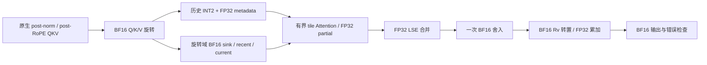

# 官方 V1 算术链修复：旋转域与合并后逆旋转

2026-10-21。用户授权修复并推送，仅交付 codex/oscar-bf16-attention。原版27B约5点、W8A8约0.5点的损失是用户反馈，本轮没有取得新的模型分数。审计与反例见 [数值对齐审计](oscar_official_numerical_alignment_20261021.md)。

## 修复后的行为

candidate 默认启用 experimental_official_math，合同为 oscar_bf16_attention_v4。历史、sink/recent、current 使用相同的 BF16 旋转域；所有 CV normalized partial 保持 FP32，先做 FP32 LSE 合并，再一次 BF16 舍入与 BF16 Rv 转置乘法，输出 BF16。



零历史 current-only 是唯一的单源特例：旋转 Q/K/V 后调用原生 FIA，取得其完整 BF16 attention 输出，再统一逆旋转。混合历史请求不再把原生 FIA 的 BF16 current partial 提升为 FP32混入合并；current 段与其它来源一起通过新 CV 保留 FP32 partial。该变化为了消除提前舍入，速度影响未测。

## 实现与生命周期

| 位置 | 改动 |
|---|---|
| integration/official_math.py | 预分配当前步 Q/K/V 旋转；store 复用旋转结果；merge 后最终逆旋转和最终错误状态 |
| integration/impl.py、current_only_dispatch.py | q4/q1/C4/C16、main/first-draft current-only、mixed split 实际走新链 |
| csrc/kernels/attention_cv_official_* | 独立 reader，取消历史 partial 的 BF16 发布/逆旋转；保留 FP32 softmax、LSE及有界tile |
| attention_official_tasks.cpp | 同一 forward 的历史精度边界固定，source1 枚举与 reader mask 一致 |
| runtime.py | 保留原生分配，按新格式绑定旋转域窗口；最终状态/LSE和完整当前步Q旋转缓冲在KV profiling前分配 |
| serving_variants.py | 一键 candidate 同时选择新数学和四类新 reader，摘要显示 v4、all_sources_rotated、once_after_fp32_merge |
| observe/probe | 新主算子 gate；current-only、first-MTP、mixed split、prepare reuse、APC均绑定v4 oracle和真实算子调用证据 |

新窗口语义标识为 striped_rotated_fp32_v3。packed INT2 仍为144B/token/KV-head，scale/normalized-zero保持FP32；窗口字节容量与旧物理快照相同，但内容为旋转域BF16。旧 raw-space 窗口不能送入新 reader。写入仍在 attention 读取完成后，保留原生共享页、fork、抢占恢复和MTP暂存顺序。

最终 inverse/copy 的状态使用独立固定缓冲。先检查原 attention/rotate/merge/store 四个错误族，再检查最终 inverse，避免把已发生的metadata错误传播出的NaN抢报为最终逆旋转错误。冻结 status_guard 内核逐字不改，无生产回读。

准备元数据复用仍按原生 main-prefill 资格，V4不再抑制current任务。复用身份加入数学profile，同时保留splits在几何key末尾，避免任务区域尺寸计算发生变化。graph输出缓冲地址固定，源码/配置/产物身份变化经既有编译缓存机制失效，不关闭graph。

## 有意保留的适配边界

本轮修复官方 **V1 uniform、每层共享旋转** 的算术链，不声称已经匹配未取得的Qwen3.8 RotationZoo V2/逐头产物。没有擅自加入key centering、逐头clip或W8A8补偿。

保留KV256计算tile、原生GDN/SSM BF16、MTP=3、APC两态、16384预算、默认设备和端口。CUDA adaptive tile、原生FIA内部归约与Ascend不作逐位同一声明。

窗口使用明确的 native fixed-per-forward 映射：cut=min(context,max(sink,context+1-recent))，该forward所有query共用同一cut；sink_end=min(sink,context)。历史候选仍保持宽区间以复用C4/C16，再按cut遮罩；exact集合和current因果集合无缺失或重复。

这不是SGLang的8-token flush分配器。官方非final-prefill、新tail、APC命中与q1 countdown依赖不同生命周期，而且其当前mixed-KV decode明确不支持MTP。本轮不猜测或移植该状态协议。独立官方host窗口模型和源码推导保存在 official_window.py 与 window_policy_audit.md，未接入生产。v4独立oracle必须显式接收cached_quant_ends，不从当前实现输出反推golden。

现有timer脚本、采样hook、schema、汇总、生成器和旧C16计时核保持不变。旧C16内部配对hook只匹配旧aligned算子，不能用其旧证据认证新official reader。通用forward相位名称保持；本轮无测速。

## 验证与证据

新合同 configs/acceptance_official_bf16.json 在本轮算子功能验证前定义，atol/rtol仍为0.005，status/metadata/padding严格。旧FP32、v2、v3合同和oracle保留，不通过修改旧参考放行新结果。

- 独立golden覆盖：同K跨来源0.068847偏置的预期为0；3+2 split的预期为1.0；current-only包含官方BF16旋转往返；空/全mask/padding/错误域单列。
- 实际Python forward的q4/q1/C4/C16调用、旋转输入指针、一次final inverse、current-only主模型/首draft、容量与错误顺序有主机回归。
- Ascend910B4 CANN及Torch扩展完整构建；官方AscendC CPU-debug执行新writer/querycopy/prepare/readers/FP32merge，包含双KV头、S3、成熟簇、尾C1与错误域。源哈希、真实退出码和失败尝试保存于 [kernel_validation.json](../reports/official_semantics_audit_20261021/kernel_validation.json)。
- 设备probe包含固定地址graph的原输入/改query/改context、最终逆旋转/copy/guard；无NPU必须失败。本轮未连接真机，因此NPU完成、真实图捕获/回放、LongBench和性能仍未验收。

最终主机回归为714 passed、9 skipped、6 subtests passed；跳过项为已有大形状主机限制及Linux链接检查，不代表通过。CANN完整构建和11个AscendC CPU功能病例通过。主机汇总、固定源哈希和最终测试命令见 reports/official_semantics_audit_20261021/repair_validation.json。不同测试批次有重叠，不能相加。

## 启动

```bash
git pull --ff-only && bash scripts/install_serve.sh --variant candidate
```

摘要应显示 oscar_math_profile=oscar_bf16_attention_v4、attention_coordinate_frame=all_sources_rotated、inverse_rotation=once_after_fp32_merge。observe/probe入口使用同一candidate配置，旧v3 gate不能放行v4。

旋转拟合公式和recipe2未变，已有完整匹配PT继续复用，缺失才自动生成；不要求手动删除PT。正式服务使用新的空KV池和源码绑定编译缓存，不复用旧格式会话的窗口状态。

档案与D.4四问：#13–20/#148要求分离LSE/输出误差及模型质量；#126/#145要求保持跨核/跨DMA所有权；#164保留有界normal-mask BF16转换。此修复作用于有界fused FIA及当前步旋转，避免旧6499.8–6655.1ms整历史恢复结构；新增固定状态缓冲不随历史长度增长。源码、编译、CPU指令、NPU、graph、质量和速度分别记录，不能由本地通过宣称5点已经恢复。
