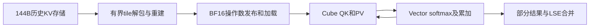

# OSCAR 32K：计算、搬运、访存证据与一对一优化方案

> **2026-10-20补证，更新C16优化顺序**：新的真实内部计时在64/64个target/rank调用中均将softmax处理链排第一；代表AIV约23.4–23.8ms，转换约7.6ms，解包约5.4ms，直接历史读取约2ms。本文原先“先试精确重建”的候选排序，**不再适用于约1189ms的C16长prefill热点**，应先处理softmax链。详情与计时边界见[新拆解报告](c16_breakdown_analysis_20261020.md)。下文保留原始PMU/decode对照，不能把新C16结果套到q4 decode。

## 结论：第一刀改OSCAR的AIV向量计算与转换

**当前最有证据支持的优化方向是：减少OSCAR的向量计算／数据转换开销。不是先提高Cube矩阵算力，也不是先优化HBM带宽。**

下面直接回答“计算、搬运、访存，到底哪个大”：

| 对象和可比较的同一管道侧 | 计算活跃占比 | MTE2读取搬运活跃占比 | 这组数据能直接说明什么 |
|---|---:|---:|---|
| **OSCAR BS4，CV的AIV侧** | **Vector 31.64%** | **8.347%** | **已展示的计算活动比读取搬运高3.79倍** |
| **OSCAR BS8，CV的AIV侧** | **Vector 32.29%** | **8.334%** | **扩batch后仍高3.87倍，特征没有改变** |
| **原生 BS4，FULL attention的AIC侧** | MAC 10.76% | **86.17%** | **读取搬运活动比矩阵计算高8.01倍** |
| OSCAR BS4，CV的AIC侧 | MAC仅2.370% | 4.174% | 不支持“Cube矩阵算力已经打满” |

证据就是原始摘要的 **L35、L89、L137**：

```text
Native FULL: aic_mac_ratio=0.1076, aic_mte2_ratio=0.8617
OSCAR BS4 CV: aic_mac_ratio=0.0237, aiv_vec_ratio=0.3164, aiv_mte2_ratio=0.08347
OSCAR BS8 CV: aic_mac_ratio=0.02364, aiv_vec_ratio=0.3229, aiv_mte2_ratio=0.08334
```

**工程判断：OSCAR先查并削减AIV侧的INT2重建、逐元素BF16舍入/转换和softmax等向量工作；原生FULL则呈现更强的读取搬运主导特征。不是“基线和OSCAR都把矩阵算力打满了”。**

**证据边界也明确写在这里：31.64%不是“计算占CV总耗时31.64%”。这些是可重叠管道的活动占比，当前复制的摘要没有完整MTE1/MTE3写回、标量及等待数据。因此，现有摘要不能证明“全部计算时间大于全部搬运时间”，也不能给出HBM访存占总耗时的百分比。AIV向量处理是第一优化嫌疑，不是已证明的独占时间最大项。若要求严格三项总耗时排名，现在的数据不足，不能编一个确定结论。**

### 这个判断为什么能解释扩batch收益弱

| 同一轮采样decode，rank0 | OSCAR BS4 | OSCAR BS8 | 变化 |
|---|---:|---:|---:|
| 自研主模型q4 attention核，16次合计 | **22.658 ms** | **39.840 ms** | **增加75.83%** |
| 公共GEMM类别 | 22.206 ms | 23.613 ms | 仅增加约6.34% |
| 整批control输出吞吐 | 31.19 token/s | 33.92 token/s | 只提高8.74% |

来源：L87、L108–109、L135、L156–157、L163–164。设备毫秒和整批吞吐是两个不同口径，没有混加。

**扩batch以后，普通矩阵工作被较好摊薄了，OSCAR独有的历史KV处理成本却明显增加。** 同BS4的CV全部为26.760 ms，原生两项attention类别合计约4.419 ms；共同GEMM和GDN基本不变。相对基线的新增成本已经定位到CV，接下来按上表优先验证其向量处理开销，而不是继续笼统调batch。

### 一对一优化：每个判断只对应一个可验证改动

| 当前证据或源码事实 | 第一项具体改动 | 怎样判断这项归因是否成立 |
|---|---|---|
| CV中AIV Vector活动显著高于已展示的AIV MTE2；源码逐D256元素重建 | **四值精确重建**：每行先按原舍入顺序计算INT2的0/1/2/3四个结果，再索引取值，减少重复Sub/Mul/Cast | 只换重建方法，其余保持；重建位域/错误合同通过后，看完整CV时间与Vector工作是否一起下降。若Gather开销抵消，就否决 |
| BF16转换helper每64元素提交一次repeat=1，存在大量小转换 | **安全的小repeat转换分组**，禁止恢复曾越界的大count接口 | 先验证UB寻址和#164故障边界，再比较完整CV；若只helper变快而CV没降，不接受 |
| q4实际4-query owner，split估组仍按21-query；history尾块固定KV256 | **按真实owner验证split候选，并减少无效尾列工作** | 保持图地址/三源/归约精度；统计有效任务、尾波和CV时间。并行度下降抵消节省则否决 |
| C16长prefill核1189.457 ms，源码每KV轮反复Restore/Spill成员状态 | **单独核算状态搬运，再试有界状态复用** | 这项属于搬运/流水候选，不能拿decode的Vector比值给它定性；新增B1重载大于节省的state流量则否决 |

这张表是10月19日基于PMU提出的候选。**10月20日新增内部计时后，C16长prefill先优化softmax处理链，再查BF16转换；精确重建后置。** q4 decode仍不能借用C16的内部占比。每次只改一个已定位因素，按完整CV净收益裁决；历史候选实现与风险保留在第7节。

## 1. 到底谁是计算 bound？

### 结论要分清“有计算开销”和“算力已经打满”

**这份数据不支持“基线和 OSCAR 都整体计算饱和”，也不支持“OSCAR 的 BF16 Cube 算力已经打满”。它支持的是：OSCAR 独有的 CV 执行路径存在严重效率瓶颈，优先嫌疑是向量处理、格式转换、片内数据周转和流水等待。原生 FULL attention 则更明显表现为搬运管道主导。**

| 比较对象 | 已有证据 | 本报告的判断 |
|---|---|---|
| 两边共有的主模型 GEMM/GDN | 同 rank0 decode：GEMM 21.662→22.206 ms；GDN 3.233→3.237 ms。prefill 公共 `target_forward` 类别1406.768→1407.210 ms | 两边都有计算密集工作；它们基本不变，不是 OSCAR 新增退化的主因 |
| 原生 FULL decode attention | AIC MAC 10.76%，AIC MTE2 86.17% | **有搬运管道主导证据**；不能直接升级为整卡 HBM 带宽饱和 |
| OSCAR CV decode attention | AIC MAC仅2.37%；AIV Vector 31.64%，AIV MTE2 8.347% | **优先按向量重建/转换及执行流水效率问题优化**；不是已证明的 Cube 算力饱和 |
| OSCAR 整轮推理 | 包含 prefill、decode、MTP、通信、等待、调度；只有少量采样窗口 | 不能给全部推理强贴单一 compute-bound/memory-bound 标签 |

这里 AIC/Cube 负责矩阵计算，AIV/Vector 负责向量计算，MTE2 是数据搬运管道。原生 FULL 的上述 PMU 来自展示的 rank2，OSCAR CV 来自 rank0；它们是各自局部管道特征，不是同 rank 逐核严格配对。

OSCAR CV 中 Vector/MTE2 约 **3.79倍**，值得追查向量侧重建、转换及 softmax 等工作；但 Vector 也只有约32%，所以不能直接说“Vector吞吐屋顶已经饱和”。低 Cube 占比还可能意味着矩阵单元在等数据、等同步或在运行不够饱满的小任务。

**因此工程决策已经清楚，硬件饱和结论还不能乱下：先优化 OSCAR 特有的 CV，不去改共同模型主干，也不把继续增加 batch 当作解决方案。**

### 为什么“加 batch 收益小”不能单独证明计算 bound

本轮 BS4→BS8 同时把请求数和总 prefill 输入翻倍，而原生调度预算仍是16384。每个请求的历史 KV 不同，不能因为 batch 变大就让不同请求共享历史重建；长 prefill 也不会因此变成零成本。执行串行、局部搬运、同步等待或算术开销，都可能让成本接近随 batch 增长。

本次**已经证明收益小**，但不能仅凭这个现象证明“芯片纯计算饱和”。同时没有 native BS8 对照，不能虚构原生4→8的扩展效率，更不能把本次4/8结果外推为31条时的精确倍率。

## 2. 本报告依据与数值口径

- 原始摘要：[user_timer_summary.txt](../reports/timer_analysis_20261019/user_timer_summary.txt)，173行，包含 `SUMMARY_COMPACTED`。
- 采样run：`0110ae8c92b44cba96268b76060f77b6`；pair hash：`4fc4197e5b483c5adc5332a45566ae4d37f08fb4f93122dace034ec0e1d0e6db`。
- 用户记录的执行提交：`37ff79d800dfa5b813dfb3ecfa9ce0c049553057`，`dirty=true`。不能称为已核实的干净源码运行。
- 32K输入、256输出，合成重复自然句；APC关闭。三个control各完成一次，抢占计数均为0。
- 48个profile窗口解析成功：三组×四rank×四窗口。`evidence=complete`说明本诊断要求的数据齐全，**不表示测到了全程所有步骤、模型质量通过或已得到严格roofline结论**。
- 本地检查源码为当前 `4e5e22c3`；与执行提交相比，本报告检查的CANN和核心attention路径没有跟踪文件差异，但不能据此排除现场dirty改动。
- 派生计算：[derived_metrics.json](../reports/timer_analysis_20261019/derived_metrics.json)。吞吐/整批相对比优先使用摘要未舍入的 `COMPARE` 比值；秒数和部分核耗时保留摘要舍入精度。

本报告只分析已给出的摘要和本项目源码，不把服务器上的完整trace假装成已读取，也不补造被压缩掉的字段。本轮没有连接真机、重跑模型或修改推理代码。

## 3. 整体表现：prefill与生成都慢，MTP不是同BS4退化的解释

| Control指标 | Native BS4 | OSCAR BS4 | OSCAR BS8 |
|---|---:|---:|---:|
| 请求数／输出token | 4／1024 | 4／1024 | 8／2048 |
| 批次wall | 约26.00 s | 32.83 s | 60.38 s |
| 输出吞吐 | 39.39 token/s | 31.19 token/s | 33.92 token/s |
| TTFT p50 | 14.797 s | 17.608 s | 30.089 s |
| TPOT p50 | 43.530 ms | 58.214 ms | 113.723 ms |
| MTP接受率：accepted/draft tokens | 76.21% | **79.91%** | 75.64% |

来源：原摘要L11–17、L67–73、L115–121、L163–164。

同BS4，TTFT p50增加 **19.00%**，TPOT p50增加 **33.73%**；首token前后都有退化。OSCAR的MTP接受率反而高3.71个百分点，因此不能把BS4变慢归咎于接受率下降。BS8的接受率比OSCAR BS4低，可能继续侵蚀扩批收益，但不能从批级计数精确拆出其耗时贡献。

TPOT是客户端SSE口径，包含并发prefill和调度影响，不等于纯decode内核时间。p95只有4或8个样本，不作为稳定尾延迟结论。BS8工作量翻倍，不能用60.38/26当同工作量退化倍率。

## 4. 瓶颈在哪里：两条CV路径，分别处理

### 4.1 长prefill：C16历史attention是第一大新增项

下面是rank0、同调度形状的续prefill窗口：实际1请求、16384个当前query token，context=32768。

| 设备任务类别 | Native ms | OSCAR ms | 解释 |
|---|---:|---:|---|
| 公共target_forward类别 | 1406.768 | 1407.210 | 主干成本几乎相同 |
| 原生native_attention | 328.135 | — | 原生attention路径 |
| OSCAR历史/window CV | — | **1199.604** | 读历史KV → 解包/还原 → 注意力计算 → 产生历史部分的结果，详见下面逐步解释 |
| 当前块原生FIA | — | 118.895 | OSCAR仍用原生FIA处理当前块 |
| LSE merge | — | 87.699 | 次级优化项 |
| Q校验/复制 | — | 30.038 | 次级优化项 |
| 量化store | — | 27.614 | 不是首要矛盾 |
| HCCL | 712.895 | 647.943 | 此窗口没有增加 |

来源：L97、L102–106、L165。`target_forward`在DEVICE_PHASES中是**归因到该scope的设备任务类别**，不是包含所有子类别的host整段包络。

#### 这1199.604 ms，OSCAR到底在干什么？

**它在做一件事：让“当前输入的token”查询“前面已经缓存的内容”，算出这些历史内容应该怎样影响当前输出。由于历史KV被压成INT2，它必须先还原数据，再计算注意力。**

这次采到的是32K输入的后半段：前面的内容已经有KV缓存，现在处理后续16384个token。这里的1199.604 ms是**这一采样窗口内多次CV内核执行的合计**，不是一次读内存的时间，也不是单个层的时间。其中C16核17次合计1189.457 ms，其余CV调用约10.147 ms。

按实际执行顺序，里面有以下操作：

| 顺序 | 用容易理解的话说 | 代码实际做什么 | 工作类型 |
|---|---|---|---|
| 1 | **找到并取出需要看的旧内容** | 根据任务和页表，逐块读取历史K/V的INT2编码、scale/zero参数；sink/recent精确窗口直接读取BF16数据 | 地址处理＋数据读取/搬运 |
| 2 | **把压缩数字还原成能算的数字** | 用移位、按位与拆出0/1/2/3编码，再用scale/zero还原数值，按合同舍入成BF16 | **向量计算＋类型转换** |
| 3 | **把还原后的数据交给矩阵计算单元** | 将当前小块K/V发布到工作缓冲，再加载到Cube侧可用的存储；发送和等待就绪信号 | 卡内数据搬运＋同步 |
| 4 | **给旧内容打相关性分数** | 计算 `Q × Kᵀ`：当前查询与哪些历史位置更相关 | Cube矩阵计算 |
| 5 | **把分数变成权重** | 做因果/窗口掩码、max、exp、sum，并更新在线softmax状态；新一块到来时还要调整之前的累计结果 | **Vector向量计算**，关键统计保留FP32 |
| 6 | **按权重取回旧内容的信息** | 计算 `P × V`，把这块历史对输出的贡献累加起来 | Cube矩阵计算＋结果累加 |
| 7 | **换下一块历史，重复上面过程** | C16让多组查询复用同一块K/V；轮到不同查询组时，要保存/恢复各组的累计输出、最大值和权重和，并等待对应计算完成 | 状态搬运＋同步，也有累加计算 |
| 8 | **把历史这一部分的答案交出去** | 扫完分配的历史后归一化；压缩历史分支还做V的逆旋转，恢复到原始输出空间；写出partial、LSE及状态 | 矩阵/向量计算＋结果写出 |

这里的 **Q** 是“当前token的查询”，**K** 是“历史内容用来匹配的特征”，**V** 是“匹配后取出的内容”，**P** 是softmax得到的权重。上述操作都在NPU上进行。

**所以，1199.604 ms混合了三类成本：还原和softmax等计算、卡内缓冲之间的数据搬运、Cube与Vector之间的等待。不能把这1.2秒全部叫作“访存时间”，也不能全部叫作“反量化时间”。** 当前计时测到了这个融合算子的总耗时，没有独立测出上面每一步各占多少毫秒。

#### 为什么压缩后反而可能慢？

原生缓存中的K/V本来就是可直接用于注意力计算的数据。OSCAR缓存虽然小，但每次消费历史时，多了**拆编码、数值还原、舍入转换、临时数据交接**这条处理链。

以一个256-token、D256的历史小块为例：

```text
约36 KiB的压缩KV
    ↓ 拆2bit编码、按scale/zero还原
约256 KiB的BF16 K/V操作数
    ↓ 交给矩阵单元，穿插softmax、累加和等待
得到这一小块历史的attention结果
    ↓ 换下一块，继续
```

小缓存节省的是**长期存放KV的容量**；它不会自动消除每次使用KV时的上述计算、交接和等待。当前一次重建好的小块已经会被复用，不能把“增加复用”泛泛说成尚未实现的新方案。

#### 哪些耗时不包含在1199.604 ms里？

| 另列的过程 | 本窗口耗时 | 与CV的分工 |
|---|---:|---|
| 当前块原生FIA | 118.895 ms | 计算当前输入块内部的注意力；这条prefill路径把当前块交给原生FIA处理 |
| LSE merge | 87.699 ms | 在CV之后，把历史、精确窗口、当前块及各split的partial结果合成最终输出 |
| Q校验/复制 | 30.038 ms | 在CV消费查询之前准备并校验Q；Q旋转也是外部准备步骤 |
| 量化store | 27.614 ms | attention读完旧数据后，再把新K/V量化并写入缓存，供后续token使用 |

因此不能再把这些单独计时的merge/store重复加进“1199.604 ms内部细分”。CV内部的在线累加和最后写partial，与CV外部的最终LSE merge是两件事。

#### 对这1.2秒，下一步具体改哪里？

**先验证第2步的重建/转换是否能缩短整个CV：只替换这一项，其他步骤不动。** 如果重建位域与错误合同保持一致，完整CV时间也下降，就有证据将收益归给这一项；如果没下降，不能宣称找对了瓶颈，再单独核第7步的状态搬运与等待。C16当前有约4 MiB/每KV轮的成员状态逻辑往返，这说明有搬运工作值得检查，但还不能写成它已占这1.2秒的大头。

源码对应：`attention_aligned_unpack.h::Unpack`负责第2步；`attention_cv_aligned_cluster16.cpp` 的 `LoadClusterKv`、`CubeCluster`、`Softmax`、`RestoreState/SpillState` 和 `PublishRows`覆盖上述链路。`impl.py` 把当前块FIA、最终merge和store作为另外的调用执行。这些是源码已确认的操作；各内部步骤的独立耗时尚未测得。

CV类别里，`oscar_attention_cv_aligned_cluster16_kernel` **17次共1189.457 ms**，占CV类别99.15%。历史CV加当前FIA为1318.499 ms，比该窗口展示的原生 `native_attention` 类别328.135 ms多 **990.364 ms**；这是展示类别之差，不是完整attention净差（其它原生FULL类别未在rank0截取项中完整展示），更不是整轮多出来的6.83秒的直接拆账。

OSCAR BS8采到的相同早段实际仍是1请求prefill，C16为1189.206 ms，几乎相同。**“客户端发了8条”并没有让这一步的16K续prefill变快。**

混合窗口要单独看：实际3请求、16380 prompt＋4 decode，OSCAR CV只有约24.66 ms，而公共target_forward约1512 ms。不能把所有prefill/mixed都当成1.2秒CV热点，也不能把一次热窗口乘任意步数充当整批占比。

### 4.2 Decode：q4/q1处理历史的成本随batch明显增加

rank0的Pipe窗口：

| 类别 | Native BS4 | OSCAR BS4 | OSCAR BS8 |
|---|---:|---:|---:|
| 实际请求／verify query token | 4／16 | 4／16 | 8／32 |
| 历史/window CV全部 | — | **26.760 ms** | **47.085 ms** |
| 其中主模型q4核 | — | 22.658 ms／16次 | 39.840 ms／16次 |
| 其中q1核 | — | 2.696 ms／2次 | 4.782 ms／2次 |
| 原生FULL类别 | 3.665 ms | — | — |
| 另一个native_attention类别 | 0.754 ms | — | — |
| 公共GEMM类别 | 21.662 ms | 22.206 ms | 23.613 ms |
| 原生GDN类别 | 3.233 ms | 3.237 ms | 4.534 ms |
| OSCAR merge／store | — | 0.715／0.640 ms | 0.787／0.661 ms |

来源：L86–110、L134–160、L167。q1不是48次；以本窗口实际打印的2次为准。主模型kernel名字的 `_25` 后缀不能解释成25个split或25个核。

OSCAR BS4的CV全部26.760 ms，相对原生两项attention类别3.665＋0.754 ms，约 **6.06倍**。这只是同窗口类别对照，含target/draft分类差异，不是可直接推广的算法倍率。

BS4→BS8，CV总时间增长 **75.95%**，每请求或每verify query的CV成本仅降低约 **12.02%**。普通GEMM却只增长约6.3%。这就是扩批后仍慢的直接证据：**共同模型工作被摊薄了，OSCAR消费不同请求历史KV的工作仍接近按请求数增加。**

## 5. PMU说明什么，不能说明什么

| CV自身的Pipe占比 | OSCAR BS4 decode | OSCAR BS8 decode | OSCAR warm prefill |
|---|---:|---:|---:|
| AIC MAC | 2.370% | 2.364% | 14.10% |
| AIC MTE2 | 4.174% | 4.429% | 23.07% |
| AIV Vector | 31.64% | 32.29% | 31.31% |
| AIV MTE2 | 8.347% | 8.334% | 17.97% |

来源：L89、L99、L137；均为所展示的CV类别加权统计，不是内部每个子阶段的独立计时。

扩batch后CV的管道结构几乎没变：矩阵单元利用占比仍低，向量处理占比仍高于同侧搬运。这支持先检查重建/转换/任务粒度/流水，而不是继续靠增加batch把Cube“填满”。但当前无法把融合核内部时间精确拆成“解包X%、softmaxY%、同步Z%”。

Memory窗口中CV的 `aic_main_mem_read_bw` 约0.094 GB/s，是导出字段经算子时长加权后的值；它不是整卡HBM吞吐。不能用这个均值断言整卡带宽空闲，也不能把AIC与AIV比例相加当成利用率。全窗口 `PIPE_EVIDENCE` 混入GEMM等其它算子，不能替代CV自己的 `PHASE_PMU`。

### HCCL为何不是现在第一项就改

| rank0 decode | Pipe窗口 | Memory窗口 |
|---|---:|---:|
| Native HCCL | 5.870 ms | 22.013 ms |
| OSCAR BS4 HCCL | 45.938 ms | **236.188 ms** |
| OSCAR BS4 CV | 26.760 ms | **26.808 ms** |

HCCL变化5.14倍，CV只变化约0.179%。HCCL task duration可能同时包含真正通信、等待其它rank、前序依赖和采样扰动；不能把77.8%的profile task-share直接当成生产固定网络占比。Native代表rank经常是2，OSCAR BS4是0，BS8 Memory又是1，直接拿代表rank互减也会误导。

profile整批wall比control分别约高15.35%、12.98%、5.91%，且MTP计数不同。这是有扰动的观测，不把全部差值断言成纯profiler开销。**先优化可重复的CV成本，并核HCCL到达等待；不先盲改网络或通信参数。**

## 6. 源码如何解释这些成本

当前历史KV每token/每KV头是144B；但矩阵计算不能直接消费INT2编码。以D256、KV256 tile为例：读取压缩payload约36 KiB，重建为K＋V共256 KiB的BF16操作数，再交给Cube。



这是源码路径图，不是各箭头耗时比例。临时操作数的GM写＋读至少是其发布payload的两遍逻辑地址访问；L2是否命中会影响实际HBM流量，不能直接把逻辑GM字节当作HBM实测。

三个必须避免的误判：

1. **当前不是全历史FP32物化。** K/V的GM临时操作数已经BF16，FP32解包中间值只在固定UB tile内。不能拿旧FP32版本的字节账解释这次BF16版本。
2. **q4已经复用同一请求的4个query。** 不是每个query都独立解包；不同请求的KV历史不同，不能跨请求错误共享。
3. **split不是全程固定20。** [runtime.py](../oscar_ascend/runtime.py)的 `splits_for_tokens` 按 `ceil(N/21)*Hkv` 估组；实际q4 ownership是4 query。若20个Cube、Hkv1、捕图N16→N32，示例S会20→10；摘要没有实际N/S，不能把示例当本次测量值。

当前C16已有16组历史复用、K/V的B1驻留、成员流水和最终Rv装载复用。下一轮不能把这些已有机制再次当成新优化收益。

## 7. 专门针对慢过程的优化实施顺序

以下是**下一轮待验证的方案**，本轮没有实施。每项只改一个主要因素，先过冻结BF16 v3精度、错误域和图合同，再比较完整路径；不以局部helper提速代替模型收益。

### P0：先用已有产物补齐CV工作量账，不重跑整批

1. 从既有window/step/trace/build记录提取q4/q1/C16各自的layer、target/draft、实际query、捕图padding、split、history长度和有效任务数；缺失字段明确标为待证实。
2. 将C16的17次调用与decode的16次q4＋2次q1按真实scope区分，避免把draft和target混为一类。
3. HCCL按同rank同step与前序CV关系看等待，先不改通信。若时钟未校准，不凭跨rank绝对时间构造关键路径。
4. 对后续候选记录完整源码/产物身份，避免只保留dirty=true而无法解释A/B差异；使用已有构建记录，不恢复部署前的大规模环境审计。

### P1-A：Decode按真正q4任务粒度重审split，再处理尾块

**针对：**q4 22.658→39.840 ms和q1 2.696→4.782 ms。

源码位置：`runtime.py::splits_for_tokens`（约110–125行）；`attention_cv_aligned_decode.cpp` 的ownership（约142–159行）、history预取（约686–705行）和history QK/PV（约736–742行）；`attention_tasks.cpp` 三源任务（约128–149行）。

实施步骤：

1. 将静态算子家族与实际owner宽度纳入拆分评估：q4、q1、长query不能继续只按同一种21-query组估计成本。候选选择仍由捕图固定形状决定，不加入每层GPU→CPU长度回读。
2. 为BS4/8及尾batch预先比较少量S候选，记录有效leader、每任务KV tile数、重复Q/Rv/partial发布和尾波利用率。不能机械改成 `ceil(Cube/B)`；例如20核下24个任务会有第二波只有4个任务。
3. 研究history与短window/current不同任务粒度，减少短源的空split与重复固定成本；三源都必须保留，不能用删计算制造收益。
4. history路径当前QK/PV按KV256处理尾块；参考同文件已有 `TailColumns` 规则，减少最后tile无效列及完全越界子块的解包/转换。必须仍初始化被读取的分数/工作区尾部。

**增加的成本与风险：**split太少会降低并行度，过多会放大固定成本；改变分段会改变浮点归约分组。不同source粒度还会影响task/status/merge ABI，不能一次全改。

**通过条件：**先维持三源ABI只试route-aware S与安全尾块；有效KV范围、错误码、padding和图地址严格保持，冻结v3容差通过。以q4/q1完整核及调用链下降为准；若尾波、merge或等待增加抵消节省，就否决。

### P1-B：减少INT2重建中的重复向量算术与转换

**针对：**decode低Cube占比、较高Vector占比，以及prefill/decode都存在的重建链。

源码位置：`attention_aligned_unpack.h::Unpack`（约103–157行），`attention_cv_aligned_decode.cpp` 的操作数发布（约676–684行）。

实施步骤：

1. 分开mode0 prefill与mode1 decode的精确计算顺序。decode的metadata、差值、乘积有指定BF16舍入点，不能合并或删除。
2. 每行INT2只有0/1/2/3四种code。先按同一scale/normalized-zero和同一舍入顺序计算四个结果，再以code索引获取结果，研究替代每个D256元素重复的浮点重建。
3. 查表、索引和结果都限制在当前tile；保持144B缓存格式及原始BF16精确窗口。只检查实际使用值，不能因未使用的LUT项溢出而新增错误。
4. 统计替换后减少的Sub/Mul/Cast及增加的Gather、索引、UB占用和屏障；同时测完整C16、q4、q1，不能只测四值计算helper。

**通过条件：**重建结果在约定BF16位域一致；FP32 metadata、错误优先级、NaN/Inf、下溢、padding及边界全覆盖。四个代表值替代256个元素运算是工作量机会，**不是64倍提速承诺**；若Gather更贵则放弃。

### P1-C：C16专项核算状态与score/P交换，再决定重排

**针对：**续prefill C16每窗口约1.189秒；这是prefill第一大自研热点。

源码位置：`attention_cv_aligned_cluster16.cpp` 成员流水和 `RestoreState/SpillState`（约1110–1129、1150–1163行）。

1. 当前一个KV256轮次处理16个member，反复恢复/保存FP32 accumulator。按源码形状，逻辑读写约4 MiB＋32 KiB状态统计，另有Cube更新及score/P交换；这不是已测HBM字节。
2. 先建立完整活跃内存与依赖账：哪些数据必须GM交接，哪些已在B1驻留，哪些等待能重叠。当前已有K/V复用，不能再次把“共享历史”当新收益。
3. 评估很小的KV superblock或成员分组，在允许的UB/L1生命周期内减少state往返；16个完整accumulator约2 MiB，不能强塞进约184 KiB级别的UB预算。
4. 先算交换代价再写候选：保留state可能造成更多K/V B1重载。若新增重载/等待大于省下的state通信，直接否决朴素循环交换。

**通过条件：**完整kernel时间及有效流水效率改善，新增workspace计入实际KV容量；不能拿扩缓存挤掉可驻留请求换局部速度。保持member所有权、atomic/Fence顺序、read-before-write、padding与LSE精度。

### P2：转换指令、merge与Q复制，按风险分开做

| 候选 | 已测规模／现状 | 具体步骤与约束 |
|---|---|---|
| 有界BF16转换批处理 | `attention_bf16_cast.h` 每64元素repeat=1；D256/KV256仅K/V发布即约2048次这类Cast，decode差值舍入还有额外同量级转换 | 研究小的、显式normal-mask多repeat分组；先逐段证明UB寻址边界，再做实际指令/canary/NaN/图验证。**禁止回到#164出错的大count overload**；这是高风险候选，不能先全局替换helper |
| LSE merge跨行向量化 | prefill约87.699 ms，decode约0.715 ms | 原 `merge_lse.cpp` 属冻结集，新增独立候选；减少逐行小读写，保留FP32 max/sum/LSE和NaN/空源处理。不要为prefill收益损害小decode |
| Q校验/复制去冗余 | prefill约30.038 ms | `aligned_math.py` 当前matmul写临时Q再校验复制。研究直接写固定QR，校验核只做状态/padding；保留原有限性归约错误语义及固定图地址 |

### P3：Writer、metadata与HCCL随后处理

- **Writer约27–28 ms，不是1.2秒C16的替代靶点。** `store_aligned_int2.cpp` 当前每tile8行，K/V共16次逐行量化；D256做完整绝对值排序，K `.96` 对应升序245、V `.92` 对应235。先研究slot/position批量读取、连续页段写入及padding在重计算前分流；精确kth选择只能在完全保持阈值与FP32 scale/zero的条件下研究，不能关闭clipping。
- **Metadata复用已经存在。** 先核命中次数、projection连续化与等待，再考虑扩范围；不能把host `prepare=752ms`直接当纯CPU元数据计算。GPU异步背压也会落在这个包络。
- **HCCL先分清等待再优化。** CV改善后看同rank、同窗口collective是否同步缩短；只有真实通信字节/链路利用率/到达等待证据成立，才调整通信。不能修改原生TP/GDN来掩盖CV成本。

**不作为首轮：将Rv移到history split合并之后。** 当前每split先归一化、BF16舍入、Rv再merge；把Rv后移会改变舍入位置，不是无条件等价变换。不得修改oracle来迁就结果。

## 8. 如何确认优化真的解决问题

先追平这次同BS4原生，需要OSCAR自身32.83秒再降低约 **20.81%**。这不是任意小核做快20.81%就能完成，必须减少实际关键路径上的成本。

验证顺序固定为：

1. 冻结当前母源、配置、v3容差、144B格式和原PT；不改模型、MTP3、APC、16384预算、设备端口及native调度。
2. 每个候选先做源码寻址/UB/L1生命周期和独立数值对照；包含padding、坏metadata、q1/q4、current/history/window及prefill/decode两种重建模式。
3. 本地编译、CPU功能与必要指令验证分开记账。涉及#164转换或#145流水依赖时，不能只凭CPU结果替代设备验证。
4. 后续单点设备验证使用短、明确形状的probe；完整相关路径下降才进入组合。组合收益按新基底重新测，不能把多个百分比相乘。
5. 保留这批现有证据，不索要AISBench或重复完整负载。确需新验证时先准备好限定范围的候选探针；本轮只提交报告，不执行优化或测速。

D.4旧全历史恢复6499.8–6655.1 ms、写路径209–216 ms只作为结构性警戒，不能算成本轮测量。禁止全历史BF16/FP32恢复、静默原生回退、关闭MTP或放宽精度。内部代码已存在的优化不能重复计账。

**执行优先级：C16 prefill与q4/q1 decode → 任务拆分/尾块和精确重建 → C16状态通信 → 有界转换、merge、Q复制 → writer/metadata → 有证据再动HCCL。扩batch只能是检验优化是否成功的手段，不能替代这些工作。**

## 源码入口

| 文件 | 本报告关注的实现 |
|---|---|
| [runtime.py](../oscar_ascend/runtime.py) | `splits_for_tokens`、固定workspace与projection |
| [attention_cv_aligned_decode.cpp](../csrc/kernels/attention_cv_aligned_decode.cpp) | q4/q1 owner、history预取、QK/PV尾块、split内Rv |
| [attention_cv_aligned_cluster16.cpp](../csrc/kernels/attention_cv_aligned_cluster16.cpp) | 成员复用、B1驻留、状态恢复/保存及流水 |
| [attention_aligned_unpack.h](../csrc/kernels/attention_aligned_unpack.h) | 两种精确重建与舍入模式 |
| [attention_bf16_cast.h](../csrc/kernels/attention_bf16_cast.h) | #164安全转换边界 |
| [aligned_math.py](../oscar_ascend/integration/aligned_math.py) | BF16 Q/K/V旋转与校验发布 |
| [store_aligned_int2.cpp](../csrc/kernels/store_aligned_int2.cpp) | clipping、量化、metadata和精确窗口写入 |
| [merge_lse.cpp](../csrc/kernels/merge_lse.cpp) | 冻结FP32合并语义；只能新增候选 |
| [impl.py](../oscar_ascend/integration/impl.py)、[prepare_reuse.py](../oscar_ascend/integration/prepare_reuse.py) | 实际调度、三源、当前FIA、写入顺序与已有复用 |

本报告所有优化项都是待验证方案，不表示已实现、已取得对应提速或已确定融合核内部各步骤的真实占比。
