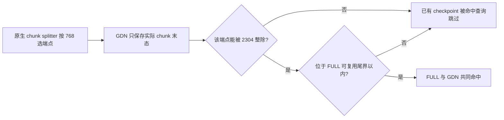

# PC 低命中：768 / 2304 checkpoint 对齐排查与修复

日期：2026-10-23。范围：当前工作树、项目内固定原生参考、本地主机协议复现。用户没有保留旧实测数据，本次不要求补数据、不连接真机、不运行性能实验。

后续用户明确授权修复并推送。外部插件现已实现下述共同边界、末端查询上限和小预算推进修复；原排查的三个分支保留用于复现，新增 `oscar_fixed` 分支执行生产函数。设备验收仍单列，不由本地命中 token 数替代。

档案依据：#26（命中后的精确窗口不能从 INT2 补回）、#37–49（物理所有权、提交和回滚）、#127（none 请求跨度不能当 FULL 页对齐）、#128（metadata128 与物理页分离）、#157（旧日志的 0% 不构成唯一故障归因）。本次没有新增真机错误，不追加真机档案。

## 结论

用户提出的方向成立：**存在 checkpoint 生成边界与共同命中边界不一致的源码缺口，即使未开启 MTP，该错位也能令相同前缀的命中为零。** 更准确地说，2304 是当前条件几何下 OSCAR FULL 物理页能容纳的 token 数，不是 GDN 状态张量变成了 2304 token。原生 GDN 的状态形状、768-token 逻辑块仍然保留。

断点位于 scheduler → GDN checkpoint → hybrid lookup 接缝：OSCAR 转换了 FULL spec 的物理块长，查询端正确采用新 FULL/GDN 的共同边界；原生 Mamba chunk splitter 仍采用转换前的 `cache_config.block_size`。已经生成的部分 GDN checkpoint 因此永远无法被查询端接受。

这不是“FULL snapshot writer 按 768 写错”的证据。本次核对的 writer/reader 使用相同的 FULL 物理页几何，长 chunk 跨过多个 FULL 页时，每页仍保留自己的精确尾窗口，即当前 v4 的旋转域 BF16 窗口。`integration/official_math.py:66–78` 传入旋转后的 K/V 与 `state.spec.block_size`；`csrc/kernels/store_aligned_int2.cpp:162–182` 按物理页定位并保留每页尾部259行，不是保存原始空间 K/V 的第二份缓存。

该缺陷已由本地固定源码执行复现；不能由此反推用户已丢失的旧运行中，各原因分别占多少，也不能声明真机命中率已经恢复。

## 几何与调用链

| 层次 | 当前 APC align 条件示例 | 作用 |
|---|---:|---|
| 原生 GDN / Mamba block | 768 tokens | 状态在原生逻辑块表中的索引单位 |
| 原生 FULL block | 768 tokens | 原生 BF16 完整页复用粒度 |
| OSCAR FULL physical block | 2304 tokens | INT2 页与该页精确窗口的共享所有权单位 |
| OSCAR metadata block | 128 tokens | attention / MTP 虚拟索引视图 |
| 原生 hash 粒度 | gcd(2304, 768) = 768 | 前缀链 hash；更细 hash 不代表可在任意该边界恢复 |
| 共同命中粒度 | lcm(2304, 768) = 2304 | 所有 FULL 和 GDN 同时有效的命中长度 |

条件示例为 D256、每 rank 一个 KV head、SSM 区 393216 B。当前 FP32 metadata 的 token 大小为 144 B，`floor(393216 / (768 × 144)) × 768 = 2304`；旧 136 B 格式在该条件下也得到 2304。不能把这个数硬编码到其他 head 数、状态 dtype 或 none 布局。

源码入口：

- `oscar_ascend/layout.py:125–136`：align 容量按原生 Mamba block 与 kernel128 的 LCM 推导。
- `oscar_ascend/integration/specs.py:106–150`：仅替换 FULL spec；GDN 对象、状态 dtype/shape 与 block 保持原样。
- `references/vllm/vllm/v1/core/kv_cache_utils.py:593–656`：正确计算 scheduler LCM 和 hash GCD。
- `references/vllm/vllm/v1/engine/core.py:145–156`：将 LCM 作为 `block_size` 传入 scheduler；scheduler 已有正确的 `self.block_size`。
- **`references/vllm/vllm/v1/core/sched/scheduler.py:319–334`：Mamba 切块却另取 `self.cache_config.block_size`，仍为 768。**
- `references/vllm/vllm/v1/core/single_type_kv_cache_manager.py:1165–1193`：跨 chunk 的中间 GDN 块填 null，仅分配实际运行状态及 speculative 所需块。
- `references/vllm-ascend/vllm_ascend/ops/gdn.py:424–444`：prefill 算子返回每个序列的末态，写入该序列的 state index；不是为跨过的每个 768 边界都生成 checkpoint。
- `references/vllm-ascend/vllm_ascend/patch/platform/patch_kv_cache_coordinator.py:232–239,315`：共同命中要求 LCM。
- **`references/vllm-ascend/vllm_ascend/patch/platform/patch_mamba_manager.py:40–45`：明确过滤不能被该 LCM 整除的 GDN checkpoint。**



## 本地反例与证据入口

复现工具：`tools/experiments/prefix_checkpoint_audit.py`。它只用于本地研究，通过 AST 装载项目内固定原生 scheduler、Ascend hybrid coordinator、Mamba manager 与 BlockPool；没有服务入口导入它。首次排查结果保留为 [`audit_before_fix.json.gz`](../reports/prefix_checkpoint_alignment_20261023/audit_before_fix.json.gz)，包括实际源码指纹、chunk 端点、已保留的 GDN checkpoint、落在共同边界的 checkpoint 与最终共同命中。落在共同边界还不等于满足最后 token / MTP 查询尾界。完整JSON无损压缩保存，工具仍输出普通JSON，避免将大量重复病例行混入源码diff。

复现使用显式合成的重复 token 前缀身份，先完成种子请求的 prefill，再查询相同前缀；没有声称执行了模型数值或完整异步 scheduler。16384 是冻结预算；“剩余预算”病例是在总预算不变时模拟其他请求占用部分预算，不改服务 argv。

| 合成 prompt 长度 | MTP | 每请求每步剩余预算 | 原生复用 token | 当前 OSCAR 复用 token | 仅共同对齐研究对照 |
|---:|:---:|---:|---:|---:|---:|
| 15000 | 关 | 16384 | 14592 | **0** | 13824 |
| 16000 | 关 | 16384 | 15360 | **0** | 13824 |
| 32768 | 开 | 16384 | 31488 | **16128** | 29952 |
| 32768 | 开 | 15360 | 31488 | **0** | 29952 |
| 65536 | 关 | 15360 | 65280 | **46080** | 64512 |

研究对照只在隔离 splitter 对象中将对齐粒度换成共同边界，其他 spec/manager 不变；不是生产实现。第一行足以证明错位可以独立于 MTP 造成零命中。第四行说明总预算完全不变，仅合法的每请求剩余预算变化就可能让命中进一步消失。

本地执行了 **168 个合同病例**：三种研究分支 × 七种长度 × MTP 开/关 × 四种剩余预算序列。新增 11 项回归与既有 prefix 测试合计 **35 passed**。对照中整除尾界和低预算的失败如实保留，不把全部168例称为通过了生产验收。

```bash
.venv/bin/python -m tools.experiments.prefix_checkpoint_audit --output reports/prefix_checkpoint_alignment_20261023/audit.json
.venv/bin/python -m pytest -q tests/test_prefix_checkpoint_audit.py tests/test_prefix_caching.py
```

上述是本地开发命令，不是真机前置步骤，也不要求用户运行。源码基底为 `48be7610fd57f74cc01ff52ed189ac61294f0761` 加当前工作树；参考 HEAD 为 vLLM `0fc695fc6d1d82e9a5ac6835ac8e4e1c83703665`、vLLM Ascend `19e436985102f4ed3aad36c137a6481653688a6c`。JSON 逐文件 SHA256 绑定实际执行内容，不能仅凭参考 HEAD 声称其工作树没有其他变化。

### 为什么默认 16384 也不能排除错位

16384 向下按 768 对齐得到 16128，而 16128 恰好等于 `7 × 2304`。因此只看第一个长 chunk 会误以为没有问题。

最后一个可缓存 chunk 的截断，和有其他请求占用预算后的每请求可用 token 数，并不保证这个巧合持续成立。例如 MTP 关闭、15000-token prompt，原生 splitter 生成累计端点 14592、15000；14592 是 `19 × 768`，却不是 2304 的整倍数，最终 GDN 没有可被共同查询使用的 checkpoint。

MTP 开启、32768-token prompt 的原生端点为 16128、31488、32768。末端 checkpoint 31488 是 `41 × 768`，同样不是 2304 的整倍数；查询只能退到更早的 16128。不能把这种大幅回退解释为仅损失一个 2304-token 尾块。

## 另外两个确定的命中限制

### MTP 丢尾页的单位随 FULL 物理页放大

`KVCacheManager.get_computed_blocks` 先将查询上限设成 `L - 1`，确保重算最后一个 token 得到 logits（`kv_cache_manager.py:215–225`）。`FullAttentionManager.find_longest_cache_hit` 再取完整物理页，MTP/EAGLE 时额外 pop 一页（`single_type_kv_cache_manager.py:547–568`）。

在相同完整前缀、无驱逐且所有 FULL 页可用的条件下，单 FULL 组上界为：

```text
FULL_upper_bound = max(floor((L - 1) / B) - mtp_drop, 0) * B
```

`mtp_drop` 为是否应用原生 EAGLE drop 的 0/1，而不是草稿 token 数 3。GDN checkpoint 的稀疏性还可能进一步降低最终命中。

例如 L=4000、开启 MTP：原生 B768 的 FULL 上界为 3072，OSCAR B2304 为 0。**仅修 chunk 对齐不能消除这一物理块粒度损失**；不能为了增大命中率删除正确性所需的 drop 或假称支持部分页复用。

### GDN checkpoint 稀疏，任意公共前缀不一定有状态

即使所有生成端点都改成 2304 的倍数，GDN 仍只保存实际 chunk 端点的状态。例如种子请求仅在 16128、29952 留下可用状态，下一条请求只共享前 8000 token，没有 ≤8000 的 GDN checkpoint，仍可能零命中。FULL INT2 页与精确尾窗口存在，并不足以重建任意较早位置的 GDN 状态。

加密 checkpoint 需要更多实际切块，或让 GDN 产生并保存中间状态；这会改变执行次数或状态协议与容量成本，属于独立设计，不能把它作为一行对齐修复偷偷加入。

## 为什么既有验证没有发现

`tests/test_prefix_caching.py:92–103` 的 `_cache_seed` 每隔 768 token 人工为所有 manager 保存一次状态，因此恰好填满了真实长 chunk 没有生成的中间 checkpoint。它验证了 hash、共享页、refcount、释放、驱逐和 MTP drop，不能证明真实 scheduler 会产生可读 checkpoint。

`tests/test_runtime_native.py` 已验证 2304/768/128、LCM 和 GCD，但没有把这些值与真实 chunk splitter 连起来。`tools/probe_prefix_cache.py` 预先构造完整共享页，验证 writer → page → reader，也没有执行模型调度生成 checkpoint 的过程。这些验证仍有价值，新增 cadence 反例补的是不同的接缝。

## 安全修复应满足的边界

实现同时遵守以下边界：

1. 仅在实际 OSCAR + APC + `mamba_cache_mode=align` 范围内，根据真实组的共同边界选择 chunk 末端；不硬编码 2304。
2. 保留 GDN block768、hash768、物理页预算、状态 shape/dtype 和 metadata128。**不能全局把 `cache_config.block_size` 改成 2304**：`patch_mamba_config.py:109–144` 会据此改变 native 页字节和 Mamba block。
3. 按绝对累计位置选合法末端；不能仅对本轮预算取整而忽略 prefix hit、恢复或外部已计算起点。
4. 末端 checkpoint 必须同时满足真实 `num_tokens - 1` 查询上限及 FULL 的 MTP drop。单纯把 splitter 局部 B 替换为 2304，整除边界仍有漏洞：L=9216 且开启 MTP 时它会选择 6912，而真实 FULL 查询最多接受 4608；如果没有更早状态仍然零命中。本轮 4608/6912/9216 的整除 prompt 在原生768对照也出现零命中，属于原生终端边界缺口，不能独归 OSCAR。关闭 MTP 时整除 prompt 也可能只留下 prompt 末端状态，仍被 `L-1` 上限排除。
5. 保留正常 decode、原生异步提交/拒绝回滚、同一步 GDN 发布屏障、refcount/驱逐及所有 FULL/draft 层的一致边界。不能将未接受的 MTP 状态广告成可共享 checkpoint。
6. 不修改冻结 16384 总预算、argv、timer、精确窗口、量化配方或 CANN 算子。需要验证低剩余预算下的调度推进，不能以等待足够预算导致饥饿。

本地研究中的“仅共同对齐”假设分支只用于说明因果，不是用户端部署补丁；生产修复同时处理末端和低预算边界。

## 已实现的外部插件修复

`oscar_ascend/integration/prefix_checkpoint.py` 在原生 Scheduler 初始化完成后读取真实 manager/spec，绑定不可变策略。仅实际 OSCAR FULL + APC + align 使用该策略；APC关闭、none、普通native沿用原函数。`plugin.py` 通过现有延迟、可恢复导入钩子包装 `_mamba_block_aligned_split`，不替换 scheduler 类，也不覆盖原生文件。

- 共同边界来自实际 FULL/GDN 块长的 LCM，并校验它等于 scheduler 与 coordinator 已解析的值。768、2304、128均未作为生产常量写入。
- 末端位置以 `request.num_tokens - 1` 为查询上限，逐 FULL group 保留该 manager 原生 EAGLE/MTP drop 所需完整页，再向共同边界取整。使用实际 group 标记，不把三个 draft token 误算成三页，也不重复执行 drop。
- 在可缓存区间内按累计绝对位置对齐，包含已有本地命中、原生状态对齐的外部已计算 token 与恢复请求。能够到达末端时先准确停在末端；后续尾部重新调用原生 splitter，不直接放行剩余预算。
- 若当前剩余预算不足到达共同边界，允许按原生 GDN 状态块推进，后续到达共同边界时停住。因而总预算不变、剩余2048/768时仍可连续推进，不等待凑出一整页2304。若连下一个原生状态边界也无法到达，保留原生零调度语义。
- 正常 decode 不进入新切分；状态分配、计算、提交、MTP拒绝回滚、哈希登记、同一步发布屏障和驱逐仍由原生完成。没有伪造中间状态、增加精确窗口或从INT2恢复窗口。
- 对未落在原生状态边界的 streaming/external 起点、有 encoder/MM 输入的请求，仍调用原生 splitter。避免新造 warm q4 状态槽混淆，或在原生 encoder 调度检查之后再次切断完整输入范围；不宣称本补丁已改善这些范围的命中。

交叉审查发现并撤除了修复初稿的一个尾部风险：`29952 → 32000 → 32768` 会令原生 pool 将代表32000末态的页登记为32256 checkpoint。保留原生尾部后，同预算序列实际端点为 `16128 → 29952 → 31488 → 32256 → 32768`。测试用原生块身份加符号化末态位置标签捕捉此错误，包含错误实现的负控；不把符号标签称为真实 GDN 张量执行。

最终相关主机测试 **227 passed**：新增对齐/末端/状态身份测试，真实 `Scheduler.schedule` 的 waiting/running 路径、插件初始化/恢复/被动模式、spec/hash身份、APC开/关完整冻结argv，以及既有runtime/prefill状态合同。测试初始化和 allocator 使用明确的host fixture；没有将其称为完整引擎或NPU执行。最终四分支矩阵见 [`audit.json.gz`](../reports/prefix_checkpoint_alignment_20261023/audit.json.gz)，其中修复分支直接调用生产策略，并在策略返回None时执行原生 splitter，与插件一致。摘要、测试命令及源码/报告指纹见 [`validation.json`](../reports/prefix_checkpoint_alignment_20261023/validation.json)。

| 合成前缀 / MTP / 剩余预算 | 修复前命中 | 修复后命中 |
|---|---:|---:|
| 15000 / 关 / 16384 | 0 | 13824 |
| 32768 / 开 / 16384 | 16128 | 29952 |
| 32768 / 开 / 15360 | 0 | 29952 |
| 65536 / 关 / 15360 | 46080 | 64512 |
| 6912 / 开 / 16384 | 0 | 2304 |
| 9216 / 开 / 16384 | 0 | 4608 |

修复分支在本次84个完整重复前缀病例达到独立原生 FULL finder 返回的上限；这不表示任意公共子前缀均有GDN checkpoint，也不是实际流量命中率或提速结果。保留完整页MTP drop及稀疏状态的固有限制。

实际生效时 EngineCore 打印：

```text
[oscar] PREFIX_CHECKPOINT_FIX joint_tokens=2304 gdn_tokens=768 terminal=last_token_and_full_drop low_budget=native_state_blocks
```

该行的数值来自实际 spec，不是设备执行验收。直启与 observe 共用插件，无新增研究开关。固定 candidate 默认 APC=false 保持；使用已有 `--enable-prefix-caching` 模式时自动生效：

```bash
git pull --ff-only && bash scripts/install_serve.sh --variant candidate --enable-prefix-caching
```

`--rear-cards` 仍是已有显式可选模式。CANN、timer、recipe3/PT、FP32 metadata读端、窗口与冻结argv均未更改。

## 统计口径与验收状态

日志的 PC 百分比是 token 加权的命中率，默认统计最近 1000 请求：`queries` 加完整 `request.num_tokens`，`hits` 加共同可复用 token 数（`metrics/stats.py:42,77–111,134–145`；`kv_cache_manager.py:228–234`）。它不是“有命中的请求占比”。冷请求、独有 suffix、驱逐会影响它，但没有旧数据不能确定其贡献。

当前 `configs/target.json` 及 candidate 默认 APC=false，显式 PC 模式才进入这里讨论的 align 路由。这是当前启动事实，不能用它否定或解释用户此前开启 PC 时的低命中。旧 `docs/prefix_caching_compatibility.md` 的默认开启描述已由后续 stable 政策覆盖。

| 验证层次 | 本轮状态 |
|---|---|
| 当前源码及原生协议 | 已定位生成/查询粒度缺口 |
| 本地 native AST 调度与缓存管理 | 缺陷复现、修复合同及相关测试227通过 |
| OSCAR writer/reader 页几何 | 源码相符；没有发现按768错写证据 |
| 生产修复 | 外部插件已实现，按实际OSCAR/APC/align自动接入 |
| NPU、graph capture/replay、模型质量 | 本轮未执行 |
| 用户旧低命中率的完整归因 | 无旧数据，不能量化各因素 |
| 修复后服务命中率及性能 | 未测，不声明恢复 |
